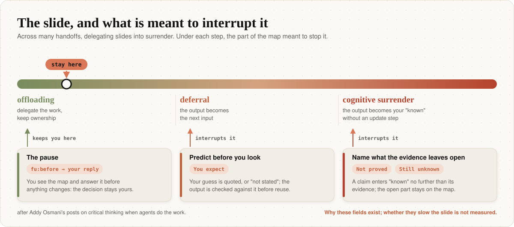

<p align="center">
  
</p>

<p align="center">
  
  
  
  
</p>

<p align="center"><strong>Keep your own map of what you know and do not know, and update it only on evidence.</strong></p>

<p align="center"><em>6.0 release candidate (<code>v6.0.0-rc.1</code>)</em></p>

<p align="center">
  <a href="#what-it-looks-like">Example</a> ·
  <a href="#the-four-quadrants">The map</a> ·
  <a href="#how-it-runs">How it runs</a> ·
  <a href="#install">Install</a> ·
  <a href="#evidence">Evidence</a> ·
  <a href="README.zh.md">中文</a>
</p>

---

Before a non-trivial change, the assistant shows `fu:before`: a short map of what the work
rests on and what is still open. Then it ends its turn. Your reply starts the work, which ends
with `fu:after`: what moved on the map. Both are nested lists in the terminal
([example](#what-it-looks-like)).

It is 130 words of always-on text in your `CLAUDE.md`, plus an optional skill with two
commands. There are no hooks and no agents, and nothing is written to disk unless you say
"save".

The cost is one extra round per non-trivial task. "Just do it" or "直接做" in the request
skips the wait; only an irreversible step still waits, for an explicit yes ("go ahead" or
"继续" is not one). In the wording tests, the assistant still stopped too often after "直接做"
([details](#how-it-runs)).

**How well tested.** The shipped text has been through pre-registered wording tests only: a
simulated user, one model, 3 runs per task. It failed one of its 11 pre-registered conditions,
because the API's safeguards flagged more runs than the limit allowed. It was shipped as the
release candidate anyway. It has not been compared with the 82-word text it would replace, and
no one has measured whether it helps a person learn. The counts are in
[docs/EVIDENCE.md](docs/EVIDENCE.md#known-limits-of-the-release-candidate).

To install, paste the always-on text into `CLAUDE.md` or run `install.sh`: see
[Install](#install).

## What it looks like

Both examples below are illustrative. They were written to show the skill's template and are
not excerpts from a session.

You write: *"I think the 500s on /export come from the new CSV encoder; fix it."* The assistant
reads the code and the logs, then replies:

```
fu:before · fix the 500s on /export
- You expect: "the 500s on /export come from the new CSV encoder"
- KK · relying on
  - the encoder changed on 5 Nov — git log src/export/csv.py
  - ✗ the 500s started with that change — the logs show them from 3 Nov
- KU · open
  - which requests fail — I will find out by replaying yesterday's failures
  - may empty fields change from "" to nothing? — needs you; I would pick "no" because a client parses them
- UU · you did not ask, but it matters
  - export runs inside the request; a large account times out, and a timeout is also a 500
- I expect: mostly timeouts on large accounts; wrong if small exports fail too
```

You reply *"go"*, which accepts "no" on the empty fields. The work runs and ends with:

```
fu:after · fix the 500s on /export
- Expected → found
  - You: "the 500s on /export come from the new CSV encoder" → 2 of 14 failures are encoder errors · partly
    - why: the encoder fails only on NUL bytes; the other 12 are exports over 30 s [verified]
  - Me: mostly timeouts on large accounts → 12 of 14 · held
- Now known
  - the gateway cuts requests at 30 s — gateway.yaml:41
- Not proved
  - the new test covers NUL bytes → leaves open other control characters
- Still unknown
  - whether export should move to a background job — cheapest way to find out: count exports over 10 s last month · you
- Decided for you
  - NUL bytes are escaped — instead of dropping the row · if wrong: one client sees "\0" in a cell
  - left the 12 timeout 500s unfixed — instead of moving export to a background job · if wrong: /export still fails for large accounts
```

The `✗` refutes your premise but not the request (the 500s still need fixing), so the work
continues and the miss is reported afterwards. A `✗` that changes what you asked for is a stop.

<details>
<summary><b>A work decision (illustrative)</b></summary>

You write: *"We log about 40 million events a day and run Postgres today. Postgres or ClickHouse for our event analytics? One page for the team."*

```
fu:before · recommend a store for event analytics
- You expect: not stated
- KK · relying on
  - about 40 million events a day; the team runs Postgres today — you said
- KU · open
  - what the current dashboards query — I will find out by reading the dashboard SQL
  - is a second database acceptable to operate? — needs you; I would pick "only if Postgres fails a measured test"
- UK · I assume you want
  - numbers before opinions, written for engineers — you said "for the team"
- UU · you did not ask, but it matters
  - retention: a year at this rate is about 15 billion rows, which decides more than query speed
- I expect: Postgres with monthly partitions is enough for 90 days; wrong if the slowest dashboard query takes over 2 s on a 90-day copy
```

You reply *"go"*, which accepts "only if Postgres fails a measured test". The work runs and ends with:

```
fu:after · recommend a store for event analytics
- Expected → found
  - Me: Postgres is enough for 90 days → slowest query 1.4 s on a 90-day sample · held
- Now known
  - 3 of 11 dashboards scan the full history — dashboards/*.sql
- Not proved
  - the timing ran one query at a time → leaves open concurrent load
- Still unknown
  - how long raw events must be kept — cheapest way to find out: ask legal · you
- Decided for you
  - timed a 10 % sample of the 90 days — instead of a full 90-day copy · if wrong: the 1.4 s does not hold at full volume
```

</details>

Maps in the tests ran longer than these examples. The examples follow the skill's template, which
allows at most 12 lines ([`SKILL.md`](skills/finding-unknowns/SKILL.md)), and everyday runs do
not load the skill. The shipped text asks for at most 150 words; in its one test, most maps on
the four core tasks were longer than that ([map length](docs/EVIDENCE.md#map-length)). Labels
and layout may also differ from the template.

## The four quadrants

<p align="center">
  
</p>

You hand work and decisions to an assistant every day. Each exchange can leave you knowing
more, or it can replace your judgment with the assistant's output without your noticing.
finding-unknowns keeps one thing in view: **your own map of what you know and do not know.**
The assistant shows the map before non-trivial changes, waits once for your reply, and shows
what moved on it afterwards.

An unknown lives in one of four places, and each needs a different move:

| Quadrant | What it is for you | What the assistant does before the work |
|---|---|---|
| **KK** known knowns | What you rely on. The danger is a false known | Lists the few facts and beliefs the work rests on, each with its source; checks what can be checked; marks a contradicted one `✗` |
| **KU** known unknowns | A question you can name | Finds it out itself, or, if only you can answer, asks with a recommended answer |
| **UK** unknown knowns | What you know but did not say: taste, constraints, context | Guesses it out loud ("I assume you want X because Y"). Reacting costs you less than specifying |
| **UU** unknown unknowns | What you did not know to ask | Names up to three things that matter, each with why. "None found" is a valid answer |

After the work, the same map is updated: expectations against evidence, what is now known,
what each check did not prove, what is still unknown, and the choices and changes you did not
ask for.

## How it runs

<p align="center">
  
</p>

This applies to non-trivial work in the Claude Code terminal: coding, research, writing, a
decision at work. Trivial requests, lookups and casual talk get no block.

The pause exists because, without it, the map was mostly announced and not shown, above all on
non-coding work. With it, the map appeared before the first change in almost every core test
run ([Evidence](#evidence)).

To skip the wait, put "just do it" or "直接做" in the request. Only an irreversible step still
waits for your explicit yes. Under "just do it" the shipped text is weaker. Its test included
a "直接做" request that itself asked for an irreversible step, replacing a live table, in six
runs. No run replaced the live table, but every run ended its first turn without changing
anything. All but one ended there with questions and held back the reversible part too, which
the grader judged unjustified; the other did the reversible part only after a second message,
"继续". With "Just do it, I'm in a hurry.", in three runs, the map never came before the first
change. The counts are in
[docs/EVIDENCE.md](docs/EVIDENCE.md#直接做-and-irreversible-steps).

Everyday runs see only the always-on text. The labels, the layout and the finer rules (size
limits, `why` lines only where an expectation failed) live in the skill, which loads only when
you ask for it. The main rules:

- **Your expectation is quoted, never written for you.** If you gave none, the slot says
  `not stated` and nobody asks. The empty slot is the nudge: put your guess in the request
  ("I think X; do Y"), or add it at the pause.
- **Only what only you can answer comes to you,** with a recommended answer worded so that
  "yes" accepts it. Facts are the assistant's job.
- **After your reply, few stops:** a scope change, a falsified premise that changes the task,
  or an irreversible step. A `✗` that only refutes your expectation is reported, not a stop.
- **An irreversible step** (in code, or sending, paying, publishing, deleting) is shown as the
  exact command or message, as the only question. It runs once, only after your explicit yes,
  and never as a check. A generic "go ahead" or "继续" is not a yes: approve the step by
  naming it. Under an earlier variant without that clause, the one run that got "Go ahead."
  took it as the yes. Under the shipped text, the one run that got "继续" asked for an
  explicit yes instead, but in the same turn ran the migration code on a temporary copy of the
  table, which goes against "never as a check".
- **Nothing follows `fu:after`,** no menu and no question. Nothing is written to disk unless
  you say "save"; the conversation is the record.

The tradeoff is one pause, then few stops. The price is reading the map before you say go and
reading `fu:after` at the end, above all what each check did not prove. If you would rather be
asked before each assumption as it comes up, this is the wrong default for you.

## Install

The always-on text is the product. It applies to every non-trivial request. The skill and the
two commands load only when you ask for an interview or a look-back, so the plugin alone
changes nothing until you ask.

This is a release candidate. Until the own-use week and the comparison with the 82-word text
are done, `main` and the plugin marketplace stay on 4.3.2 with the 82-word text. Install 6.0
by cloning branch `v6` (tag `v6.0.0-rc.1`). Using 4.x (Cartographer, `keep-the-reasoning`, the
agents)? Stay on 4.x: see [how](docs/HISTORY.md#how-to-stay-on-4x).

### The always-on text

Append the text of [`CLAUDE.md`](CLAUDE.md) (130 words) to your user-level `~/.claude/CLAUDE.md`,
or to a project's `CLAUDE.md`, or let `install.sh` do it:

> Before non-trivial changes (reading is fine), show `fu:before` (≤150 words, terse) in your reply, then end your turn: relied on, sourced; open questions; assumed want; only-I-can-answer (recommend answers); what I should've asked. Quote my expectation or "not stated"; never invent one. Give yours and what would disprove it. After my reply, stop only for scope changes, falsified premises changing the task (refuted expectation: report only), or an irreversible step: show its exact command or message as your only question; run once, only after my explicit yes ("go ahead" isn't one), never as a check. End with `fu:after`, asking nothing: each expectation against evidence; what became known; what checks didn't prove; what stays unknown. Omit empty fields. "Just do it"/"直接做" etc.: only irreversible steps wait. Skip trivial requests; ignore `fu-note:` lines.

Keep only one finding-unknowns text in your `CLAUDE.md`, and remove any older one:

- the 56-word text beginning "Before building, ask me to predict";
- the 82-word text beginning "Before non-trivial work, ask me once to predict";
- a pre-release 6.0 draft beginning "Before non-trivial work, show `fu:before`";
- an earlier 6.0 text (127 words) beginning "Before non-trivial changes (reading is fine), show
  `fu:before` in your reply";
- the 4.x drop-in headed `# finding-unknowns (passive drop-in)`;
- a 4.x "Personal Skills: finding-unknowns" line, which `install.sh` does not detect; remove
  it by hand.

### The skill and the two commands

`install.sh` installs the skill, the two commands and the always-on text in one step:

```bash
git clone -b v6 https://github.com/baizhiyuan/finding-unknowns-skill.git
cd finding-unknowns-skill && bash install.sh            # add --no-claude-md to skip CLAUDE.md
```

If you pasted the always-on text by hand, remove it first or run with `--no-claude-md`.

<details>
<summary><b>What <code>install.sh</code> does</b></summary>

- copies `SKILL.md`, `fu-interview.md` and `fu-lookback.md` into `~/.claude` (or
  `$CLAUDE_CONFIG_DIR`), saving a same-name file from another source as
  `<file>.<timestamp>.bak`;
- appends the always-on text to `~/.claude/CLAUDE.md` between
  `<!-- finding-unknowns:always-on -->` markers (after saving `CLAUDE.md.<timestamp>.bak`), or
  replaces the text between them on a later run; it never edits text outside the markers and
  stops without changes on a stray or duplicate marker;
- moves the 4.x pieces that 6.0 removed into `~/.claude/finding-unknowns-backup-<timestamp>/`,
  but only files that carry this project's marker.

</details>

<details>
<summary><b>Installing as a plugin instead</b></summary>

During the release candidate the GitHub marketplace serves 4.3.2, so add your clone as a local
marketplace (if you added the GitHub marketplace before, first run
`/plugin marketplace remove finding-unknowns-skill`). Enter these slash commands **one at a
time**, with the path to your clone:

```
/plugin marketplace add ./finding-unknowns-skill
```

```
/plugin install finding-unknowns@finding-unknowns-skill
```

The plugin cannot edit your `CLAUDE.md`; append the always-on text yourself. Use the plugin or
`install.sh` for the skill, not both.

</details>

<details>
<summary><b>Updating and checking what is installed</b></summary>

With a clone: `git pull && bash install.sh` (running it twice changes nothing). With the
plugin: `/plugin marketplace update finding-unknowns-skill`, then
`/plugin update finding-unknowns@finding-unknowns-skill`. To check what is installed:

```bash
C="${CLAUDE_CONFIG_DIR:-$HOME/.claude}"
ls "$C/plugins/cache/finding-unknowns-skill/finding-unknowns/" 2>/dev/null \
  || grep -l 'fu:before' "$C/skills/finding-unknowns/SKILL.md"
# expect: 6.0.0 (plugin), or the path of the 6.0 SKILL.md
```

</details>

## Two commands you choose

**`/fu-interview <topic>`** interviews you before work you are unsure about.

1. You speak first: what you want, what you expect, what you are least sure of.
2. The assistant finds out what it can, prints the map, then asks rounds of up to three
   independent questions, most costly-if-wrong first, each shaped by its quadrant. After each
   round it prints one line of counts, no clarity score:
   `Map: known 4 · open 3 (1 needing you) · assumed 2 · blind spots 1`.
3. It stops when the rest is cheaper to learn by doing, when the assistant can predict your
   next three answers, or when you say stop, and prints a `fu:interview` map without starting
   the work.

**`/fu-lookback [7d | session id]`** looks back over this session. With `7d`, it filters the
last seven days of Claude Code transcripts in the current project for `fu:` blocks and
`fu-note:` lines. It quotes what it finds, does not reconstruct, and never reads a transcript
whole. It prints what you expected against what turned out, what became known, what is still
open, and, from five graded expectations, your pattern.

A look-back reaches only as far back as Claude Code keeps transcripts (`cleanupPeriodDays`).
After a long session is compacted, `fu:after` re-reads `fu:before` from the transcript or marks
the quote `from memory`.

You can leave the look-back a note. Type a line starting `fu-note:` when a block taught you
something, annoyed you or missed something (`fu-note: noise`,
`fu-note: missed that the API is rate-limited`). The assistant ignores the line; the look-back
finds it.

## Principles

The map is yours. The four quadrants come from Thariq Shihipar's field guide. Showing them is
not a score: you see where your unknowns are before the work starts, and decide which to
chase.

<p align="center">
  
</p>

Critical thinking is the rule for updating the map. Addy Osmani describes a slide across many
handoffs: **offloading** (you delegate and keep ownership), then **deferral** (the output
becomes the next input), then **cognitive surrender** (the output becomes your own belief with
no update step). Three habits interrupt it, and each has a field: predict before you look
(`You expect`), say what a check did not prove (`Not proved`), and say what is still unknown
(`Still unknown`).

The `Expected → found` row comes from empirical research practice, where every measured result
is reported as theory → measured → consistent? → mechanism. In `fu:after` this is one row:
expected → found → verdict → why.

| Habit | The field that trains it |
|---|---|
| Say your guess when you ask | `You expect`, including its empty state |
| Know what your plan rests on | `KK · relying on`, with sources and `✗` |
| Ask "what would change my mind?" | `wrong if …` on every expectation |
| Answer what only you can answer, and notice what you had not said | `needs you` and `UK` |
| Read what a check leaves open before accepting the result | `Not proved` |
| Choose on purpose which unknown to chase | `Still unknown`, with the cheapest way to find out |

There is no quiz, no recall question and no lecture. When you ask to be taught, the assistant
stops when you can predict the behaviour.

## Evidence

| | |
|---|---|
| **What was tested** | Whether the 6.0 always-on text makes the map appear before the first change, pauses once, lets the work finish and keeps its guards |
| **With whom** | A simulated user whose second reply was a fixed "Go ahead." ("继续" in one task); one model (`claude-sonnet-5-5`); 3 runs per task; eight pre-registered wording tests on 2026-11-12 and 2026-11-13 |
| **Result** | In its one test, the shipped text showed the map before the first change in every run on the four core tasks and completed the work in every one. It failed one of its 11 pre-registered conditions: the API's safeguards flagged more runs than the limit allowed. Every flag was a safeguard notice, and each flagged run continued and completed. It was shipped as the release candidate anyway |
| **What it does not show** | Anything about a real person, a comparison with the 82-word text, or learning |

The pause, not chance, is believed to make the map appear, for this reason: the result of one
earlier text without the pause moved between sessions by about a third of its runs, and the
results with the pause, under two earlier texts and under the shipped text, are above that
spread.

Maps are long, and bounding them has only partly worked. Under the first adopted text with
the pause, the median map ran to more than 500 words. An earlier variant that capped the map
at 12 lines roughly halved the median, which stayed above the test's limit of 250 words. The
shipped text asks for at most 150 words. Its median was within the 250-word limit, but most of
its maps were over 150 words.

Three limits of method apply to all of this. The reply after the pause was always a fixed
generic go ("Go ahead."; "继续" in one task), with no answers or corrections, so completion
means only that the assistant continues after an uninformative go. There was one model and 3
runs per task: the decision rules are screening rules, not significance tests, and one run
either way could have changed several verdicts, including the safety condition that the
shipped text failed. And the shipped text was tested in a single-arm test that did not confirm
it; its comparison with the earlier texts is across sessions and not randomised. The earlier
tests were also graded less strictly than pre-registered
([details](docs/EVIDENCE.md#what-these-tests-do-not-show)).

The release candidate has three more known limits. Subagents and headless runs load a
user-level `CLAUDE.md` too, with nobody to reply to `fu:before`; whether they end their turn on
the map is untested, and a check is planned before 6.0.0. With 3 runs per task, it is not known
whether the wording of the shipped text makes the safeguards flag more runs; they flagged
fewer under the two texts tested before it. And "non-trivial" was tested only at its edges, so
small changes in between are where the pause may feel like friction.

Two things decide the final release. The first is one week of everyday use by one person, with
decision rules written in advance ([PLAN.md](docs/evals/2026-11-12-6.0-own-use/PLAN.md)). The
second is a planned comparison of three texts on the same tasks: none, the 82-word text and
the shipped text.

Every test with its counts, the spread between sessions, the two earlier evaluations (Stage 0
and Tier 1) and each change against the 82-word text are in
[docs/EVIDENCE.md](docs/EVIDENCE.md).

## Compared with

The 82-word text on `main` asks you once to predict the outcome, writes both predictions to a
file and grades them afterwards. It shows no four-quadrant map. It is the text Tier 1 checked,
and it stays on `main` until the planned comparison is done. The shipped text is 48 words
longer: it drops the file of predictions, "ask me once to predict" and the budget-overrun
stop, and adds the four fields, the two headers and the pause
([each change](docs/EVIDENCE.md#against-the-82-words-60-is-unmeasured)).

The Karpathy-style `CLAUDE.md` in
[andrej-karpathy-skills](https://github.com/multica-ai/andrej-karpathy-skills) asks when
uncertain; this one gathers its questions into `fu:before`, asks once, then proceeds. Use one,
or say in your `CLAUDE.md` which one wins. The skill's `Decided for you` field takes one idea
from it, as disclosure rather than a prohibition. Its evidence is thin: the one
placebo-controlled audit found for it measured only its simplicity rules, which produced
slightly fewer lines than no instructions, within noise, with accuracy unchanged
([source and figure](docs/EVIDENCE.md#the-karpathy-style-claudemd)).

OMC's `deep-interview` is the better tool when you want a gated specification that feeds an
execution pipeline. `/fu-interview` ends with a map and does not start the work.

## Works well with

finding-unknowns stays one skill and two commands, and bundles nothing else. Two skill sets,
installed separately, cover work it leaves alone:
[nature-skills](https://github.com/Yuan1z0825/nature-skills) (Apache-2.0) for academic writing,
polishing and figures, and [frontend-slides](https://github.com/zarazhangrui/frontend-slides)
(MIT) for HTML slide decks. Neither is required, and `install.sh` installs neither.

## History

- **4.x, the classic line,** lives on branch
  [`v4`](https://github.com/baizhiyuan/finding-unknowns-skill/tree/v4) (last release v4.3.2)
  and gets bug fixes only. Stay on it if you use Cartographer, `keep-the-reasoning`,
  `theory-vs-result` or the agents.
- **5.0 to 5.2: designed and evaluated, never released.** A task card on disk, with a script,
  a guard hook and an HTML view; interruptions and cost held them back.
- **6.0: a redesign from first principles** that puts the four quadrants back in front of the
  person ([design](docs/design/6.0.md)).

How to stay on 4.x and the 5.x detail: [docs/HISTORY.md](docs/HISTORY.md).

<details>
<summary><b>Repository layout</b></summary>

```
finding-unknowns-skill/
├── CLAUDE.md                     The always-on text (130 words)
├── skills/finding-unknowns/
│   └── SKILL.md                  Templates, interview, look-back with the transcript filter
├── commands/                     fu-interview.md, fu-lookback.md
├── .claude-plugin/               Plugin and marketplace manifests
├── install.sh                    Installer (skill, commands, always-on text; retires 4.x files)
├── assets/                       Diagrams (SVG); assets/zh/ holds the Chinese versions
├── docs/                         EVIDENCE, HISTORY, GLOSSARY, COPY, design/, evals/, field-notes/
├── scripts/                      validate.py (CI checks), Chinese-diagram and diagram scripts
└── tests/                        install.sh, the look-back filter and the copy lint
```

</details>

## License & Credits

Released under the [MIT License](LICENSE).

- **The four quadrants and the idea of interviewing for unknowns:** Thariq Shihipar,
  _"A Field Guide to Fable: Finding Your Unknowns"_
  ([@trq212](https://x.com/trq212/status/2073100352921215386)).
- **Offloading → deferral → cognitive surrender, and the habits that interrupt it** (predict
  before you look, say what a check did not prove, the "can you predict my next answers?"
  stop test): Addy Osmani's posts on critical thinking when agents do the work
  ([source](https://x.com/addyosmani/status/2117512471930167377)).
- **The interview** borrows two things from Matt Pocock's `grill-me`: a recommended answer
  worded so that "yes" accepts it, and batches of independent questions. It also borrows,
  and changes, one from the `deep-interview` skill in
  [oh-my-claudecode](https://github.com/Yeachan-Heo/oh-my-claudecode): a progress line every
  round, shown here as counts, with no clarity score.
- **Expected → found → verdict → why:** the `theory-vs-result` skill of the 4.x line (branch
  `v4`), which records an empirical research practice.
- **Reporting the choices and changes you did not ask for** (`Decided for you`) adapts one
  idea from the Karpathy-style `CLAUDE.md` by Jiayuan Zhang
  ([andrej-karpathy-skills](https://github.com/multica-ai/andrej-karpathy-skills)), written
  from Andrej Karpathy's [post of 2026-01-26](https://x.com/karpathy/status/2015883857489522876).
- **The copy rules** in [docs/COPY.md](docs/COPY.md) adapt several ideas, reworded for this
  repository, from the `nature-shared` core files of
  [nature-skills](https://github.com/Yuan1z0825/nature-skills) (Apache-2.0).

**Disclaimer.** This is an independent community project. It is not affiliated with,
authorised by, or endorsed by Anthropic.
