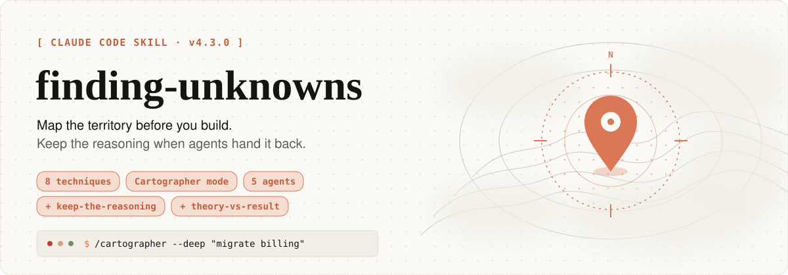
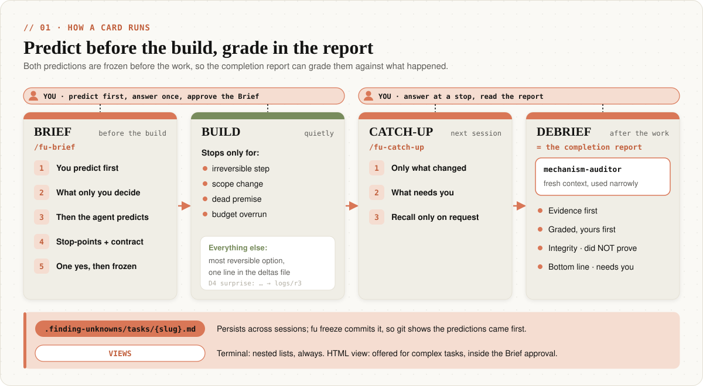
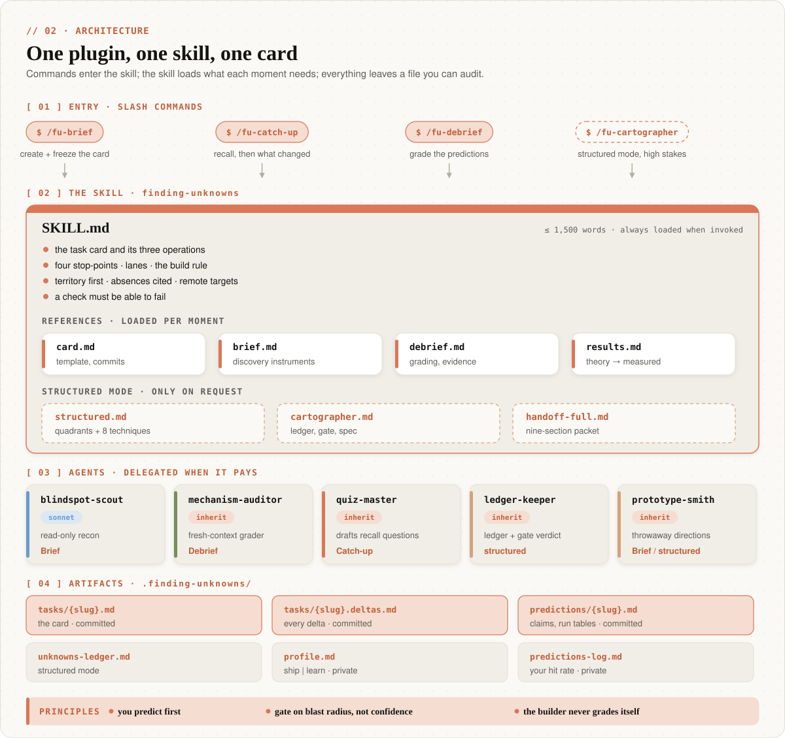
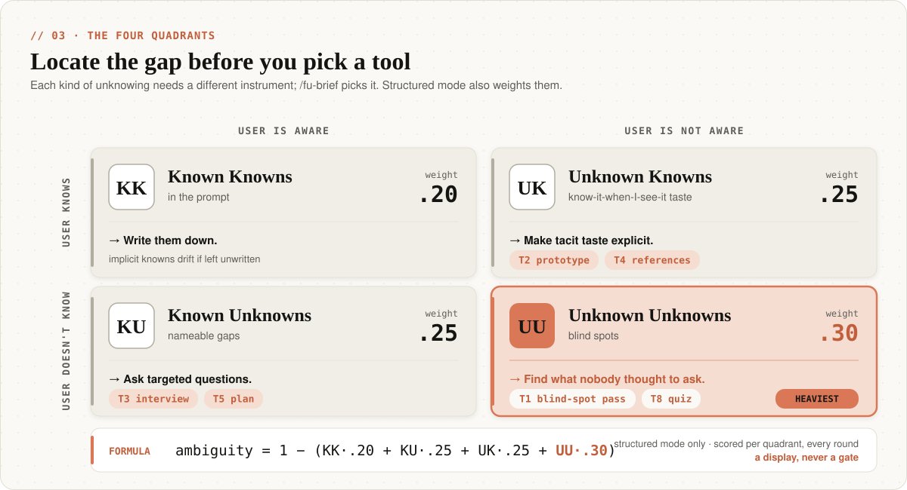
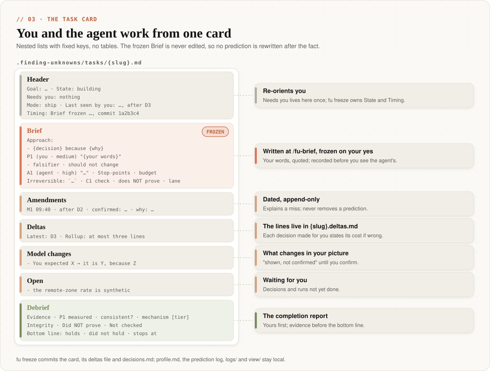
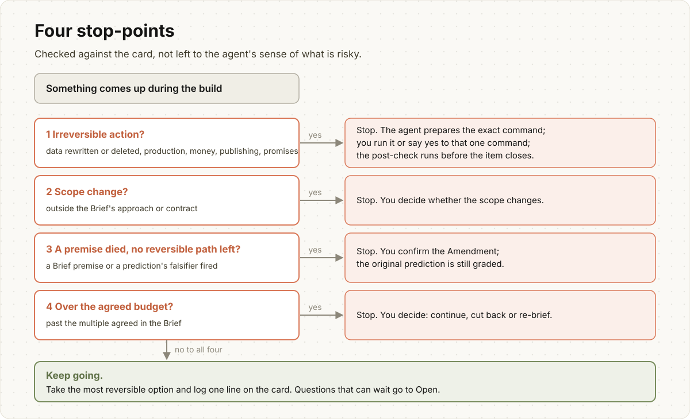
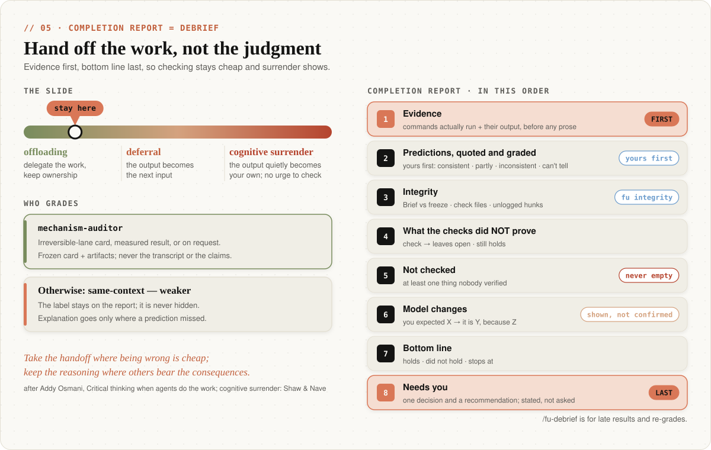
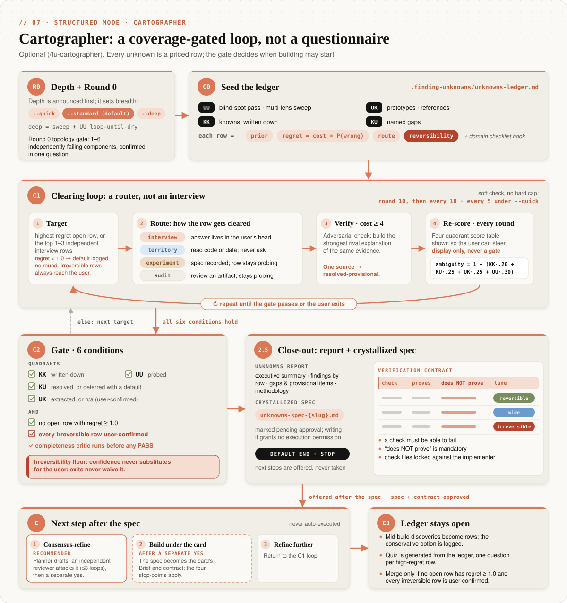

<p align="center">
  
</p>

<p align="center">
  
  
  
  
  
</p>

<p align="center"><strong>Stay the owner of work an agent does for you: know what is being done, predict what should happen, and see where reality differed.</strong></p>

<p align="center">
  <a href="#quick-start">Get started</a> ·
  <a href="#how-it-works">How it works</a> ·
  <a href="#commands">Commands</a> ·
  <a href="#documentation">Docs</a> ·
  <a href="README.zh.md">中文</a>
</p>

---

## Quick Start

Install from the plugin marketplace. These are Claude Code slash commands; enter them
**one at a time**:

```
/plugin marketplace add baizhiyuan/finding-unknowns-skill
```

```
/plugin install finding-unknowns@finding-unknowns-skill
```

Or clone and run `install.sh`, which installs the skill, its references, the five agents
and the four commands:

```bash
git clone https://github.com/baizhiyuan/finding-unknowns-skill.git
cd finding-unknowns-skill && bash install.sh
```

No install at all? Copy [`CLAUDE.md`](CLAUDE.md) into a project root for the short,
always-on version.

**First use:**

```
/fu-brief "make the export job resumable"   # you predict, territory checked, agent predicts; frozen on your yes
/fu-catch-up                                # next session: what changed (recall first in learn mode)
/fu-debrief                                 # predictions graded; what changes in your model
```

The [5-minute tutorial](docs/TUTORIAL.md) walks through one card from brief to debrief.

### Updating

Next release: **v5.0.0**, pending the Stage 0 evaluation. The current release is v4.3.2.
Update the same way you installed:

```
/plugin marketplace update finding-unknowns-skill
```

```
/plugin update finding-unknowns@finding-unknowns-skill
```

<details>
<summary><b>Clone, upgrading from 4.x, and version check</b></summary>

`install.sh` overwrites in place and removes 4.x files it recognises as its own (the
Workflow reference `workflows.md`, the separate keep-the-reasoning and theory-vs-result
skills, the old commands):

```bash
cd finding-unknowns-skill && git pull origin main && bash install.sh
```

4.x remains available from the `v4.3.2` tag. For what moved where, see
[design §11](docs/design/5.0.md#11-migration-for-4x-users).

```bash
grep -h '"version"' ~/.claude/plugins/cache/finding-unknowns-skill/finding-unknowns/*/.claude-plugin/plugin.json 2>/dev/null \
  || ls ~/.claude/skills/finding-unknowns/references/card.md
# expect: 5.0.0 (plugin) — or the card reference listed
```

</details>

---

## Why finding-unknowns?

When an agent does the work, it is easy to stop knowing what happened. You approve a
diff you skimmed, a long task drifts from what you meant, and the result becomes yours
without your judgement in it. Addy Osmani calls this slide **offloading → deferral →
cognitive surrender**. The term *cognitive surrender* comes from Shaw & Nave, _Thinking—Fast,
Slow, and Artificial_ (SSRN 6097646); Margaret-Anne Storey writes about the related
*cognitive debt*.

This plugin keeps one **task card** per task, shared by you and the agent:

- **Before the work,** you write down what you expect. The agent then maps the territory
  and only after that gives its own prediction. Your prediction is recorded before you see the
  agent's.
- **During the work,** the agent stops only at four checkable points. Everything else
  goes on the card, for you to read when you choose.
- **After the work,** a context that did not do the work grades every prediction. You see
  which ones held, what the checks did not prove, and what changes in your own picture.

The card is a file, so it survives sessions. That matters most for long tasks and for
research, where results arrive over days.

> **Attribution.** The discovery techniques come from Thariq Shihipar's _"A Field Guide
> to Fable: Finding Your Unknowns"_ ([@trq212](https://x.com/trq212/status/2073100352921215386)).
> The handoff, including "what the checks did not prove", comes from Addy Osmani's
> _"Critical thinking when agents do the work"_ ([source](https://x.com/addyosmani/status/2117512471930167377)).
> Theory → Measured → Consistent? → Mechanism is the author's own research practice.

### What the evals show

Three blinded, pre-registered evaluations ([docs/evals](docs/evals/)) asked whether the
4.x skills made current models catch more planted traps on single-turn tasks:

- **No gain survived replication.** Baselines already caught 22–23 of 25 traps.
- **A measurable cost:** roughly +10 % to +70 % in input tokens or USD, longer answers,
  and, for Sonnet, more small false claims.
- **One narrow effect, Sonnet only:** when keep-the-reasoning ran on the merge question,
  Sonnet named that "the tests pass" rested on one self-updated snapshot test in 4 of 5
  runs, against 1 of 12 without it. This was found after the fact, so it is a lead, not a
  result.

5.0 was rebuilt around the side those evals never measured: **your** understanding and
decisions ([design](docs/design/5.0.md)). Whether it helps people is **not yet tested**.
A simulated-user evaluation with a pre-registered kill rule decides whether 5.0 is
released at all; a study with real participants follows. Until then, treat this as a
way of working, not a measured improvement.

---

## How it works

<p align="center"></p>

`/fu-brief` freezes the card, the build stops only at the four stop-points, `/fu-catch-up`
re-orients you in a new session, and `/fu-debrief` grades the frozen predictions.

### Architecture

<p align="center"></p>

Four commands enter one skill. `SKILL.md` holds only what every moment needs (the card,
the stop-points, the always-on rules); everything else is a reference file loaded when its
moment comes. Structured mode is a separate layer that is never loaded unless you ask.

### The four kinds of unknowns

<p align="center"></p>

The Brief starts with your prediction. The agent then works out what kind of gap
remains, because each kind needs a different instrument:

- **Known knowns** are in your request; the risk is that they stay implicit, so they are
  written down.
- **Known unknowns** are questions you can name; the agent asks them, architecture first,
  and never asks what the code already answers.
- **Unknown knowns** are taste you will recognise but cannot specify; a few genuinely
  different directions, or a reference implementation, turn it into criteria.
- **Unknown unknowns** are blind spots; a read-only blind-spot pass looks for landmines,
  hidden constraints and the questions an expert would ask.

### The task card

<p align="center"></p>

`.finding-unknowns/tasks/{slug}.md`, committed to git by default so the commit shows the
predictions came before the results. It holds:

- a header with the goal, the state and the next decision that needs you;
- the **frozen Brief:** approach and why, your predictions and the agent's (each with a
  falsifier and something that should not change), the stop-points, and the contract
  (each check, and what it does **not** prove);
- **Amendments:** dated and append-only. The Brief is never edited, and every original
  prediction is still graded;
- **Deltas:** one line per deviation, surprise or decision made on your behalf;
- **Model changes:** "you expected X, it is Y, because Z";
- **Open** items, then the **Debrief**.

Predictions are about things the agent does not control: where the bug is, how many
callers break, a benchmark number. "Tests will pass" is a contract check, not a
prediction. Many tasks honestly have no prediction; the card then says so.

### Four stop-points

<p align="center"></p>

The agent stops for you only when one of these holds:

1. **Irreversible action:** deleting or rewriting data, production, money, publishing,
   commitments to people. The agent prepares the exact command; you run it or say yes to
   that command.
2. **Scope change.**
3. **A premise died** and no reversible path is left.
4. **Budget:** an overrun past the multiple you agreed.

Everything else takes the most reversible option and is logged on the card.

### Debrief

<p align="center"></p>

- **Predictions quoted, not restated:** each is quoted by ID from the frozen card.
- **Graded by a fresh context:** `mechanism-auditor` sees the card and the artifacts, not
  the build transcript, and grades your predictions first.
- **Explanation where it was wrong:** the explanation goes on the rows that missed.
- **Evidence first:** the commands that ran and their output, what each check did not
  prove, and what nobody checked.
- **One screen by default**, with more detail on request.

### Measured results

Benchmarks, backtests, A/B tests and training runs use **Theory → Measured → Consistent?
→ Mechanism**:

- **Prediction:** written before the data, with a stopping rule and a noise floor
  measured from at least three reruns.
- **Run table:** results arriving over days go into a run table; no verdict until the
  stopping rule is met.
- **Two verdicts:** the rule verdict is mechanical; the verdict on whether the idea is
  alive is yours.

### Learning

- **You predict first:** one skippable question in `ship` mode (the default; you are
  never asked to pick), up to three in `learn` mode, which you turn on by asking for it.
- **Explanation follows your misses:** it goes where your prediction missed, not into a
  lecture up front.
- **Recall in `/fu-catch-up`, in `learn` mode only:** before you see the card, two or three
  questions. `ship` mode asks none. There is no pass mark.
- **Prediction log:** your hit rate over time is logged for you, not committed.

### Structured mode (optional)

<p align="center"></p>

For high-stakes work, or when you want every step spelled out (which may help smaller
models), `/fu-brief --structured` or `/fu-cartographer` adds the 4.x protocol on top of the
card:

- **Quadrant routing** and the eight numbered techniques (blind-spot pass, prototypes,
  interview, references, plan, notes, pitch, quiz).
- **Cartographer:** every unknown becomes a ledger row with a prior, a regret score
  (cost × chance of being wrong), a route and a reversibility lane. A clarity display each
  round lets you steer. A six-condition gate decides when building may start, and the spec's
  verification contract becomes the card's contract.
- **The full handoff packet:** stakes triage and nine sections, evidence first.

The card, the four stop-points and fresh-context grading still apply.

---

## Commands

| Command | What it does |
|---|---|
| `/fu-brief <task>` | Take your prediction, map the territory, then give the agent's; agree the stop-points and the contract; freeze and commit the card |
| `/fu-catch-up [slug]` | Recall questions in `learn` mode, then only what changed since you last looked, and the next decision that needs you |
| `/fu-debrief [slug]` | Grade every frozen prediction with a fresh context; evidence, what the checks did not prove, model changes |
| `/fu-cartographer <task>` | Structured mode for high stakes: the Cartographer ledger, gate and spec on top of the card |

Saying "brief me", "catch me up", "where were we" or "did it match what we expected" works
too. Typos and one-liners get no card and no questions. In non-interactive `claude -p`,
use the full names (`/finding-unknowns:fu-brief`).

| Agent | Role |
|---|---|
| `blindspot-scout` | Read-only reconnaissance for the Brief: landmines, hidden context, a rewritten request |
| `mechanism-auditor` | Fresh-context grader for the Debrief and for measured results |
| `quiz-master` | Optional: drafts the recall questions for `/fu-catch-up`, and flags changes no delta explains |
| `ledger-keeper` | Structured mode: keeps the Cartographer ledger, scores and gate verdict |
| `prototype-smith` | Divergent throwaway directions for taste you will recognise (Brief, structured mode) |

---

## Design Notes

- **Why 5.0 is a rebuild.** Three evals measured the 4.x skills as a boost to model
  output and found none that replicated. The author's goal was always the person's side,
  so 5.0 is organised around it. The design, two advisor reviews, and where 5.0 departs
  from them: [docs/design/5.0.md](docs/design/5.0.md).
- **What moved.** Cartographer (regret scores, clarity displays, a six-condition gate),
  the eight numbered techniques and the nine-section handoff packet are no longer the
  default. They live on as **structured mode**, loaded only on request, because smaller
  models may need explicit steps that frontier models do not (a hypothesis under test).
  Workflow execution and the must-pass quiz are gone. keep-the-reasoning and
  theory-vs-result were merged into the one skill.
- **What was kept, on design grounds.** The irreversibility floor; checks that can fail and
  say what they do not prove; territory before questions; prediction before
  data; the two verdicts. None of these has been shown to help people yet.
- **Field notes** from real use: [docs/field-notes](docs/field-notes/).

### Roadmap

- **Stage 0:** a simulated-user evaluation, three arms (no plugin, a 60-word
  `CLAUDE.md`, the plugin). If the plugin does not beat the 60 words, the 60 words ship
  instead.
- **Smaller models:** the same simulated-user tasks with a 27–38B open-weight model,
  comparing no plugin, 5.0 and structured mode.
- **Stage 1:** 8–12 participants, a crossover against plain Claude Code, and a test of
  understanding 48–72 hours later.
- **The SessionStart hook** in [`extras/`](extras/session-start-hook/README.md) ships
  only if Stage 0 shows that it helps a new session find the card.

---

## Documentation

- **[5-minute tutorial](docs/TUTORIAL.md):** one card, brief to debrief
- **[Glossary](docs/GLOSSARY.md):** card, prediction, contract, stop-point, lane, verdicts
- **[Architecture](docs/ARCHITECTURE.md):** files, agents, data flow, design principles
- **[5.0 design](docs/design/5.0.md):** why and how, the evaluation plan
- **[SKILL.md](skills/finding-unknowns/SKILL.md)** and its [references](skills/finding-unknowns/references/card.md)
- **[Examples](EXAMPLES.md):** copy-paste prompts
- **[Changelog](CHANGELOG.md)** · **[AGENTS.md](AGENTS.md)** · **[Contributing](CONTRIBUTING.md)**

---

## Requirements

- **Claude Code:** the CLI, desktop app or an IDE extension. The Markdown also works in
  Codex.
- **No runtime, no dependencies.** Everything is plain Markdown. The agents are optional;
  without them, grading is done in the same context and labelled weaker.
- **git** for committing cards (optional; without it, timing is self-reported).
- **`bash`** only for `install.sh`.

## Project Layout

<details>
<summary><b>Repository tree</b></summary>

```
finding-unknowns-skill/
├── .claude-plugin/          Plugin and marketplace manifests
├── commands/                /fu-brief · /fu-catch-up · /fu-debrief · /fu-cartographer (thin dispatchers)
├── skills/finding-unknowns/
│   ├── SKILL.md             The card, the three operations, stop-points, always-on rules
│   └── references/          card · brief · debrief · results · results-examples; structured mode: structured · cartographer · handoff-full
├── agents/                  blindspot-scout (sonnet) · mechanism-auditor · quiz-master · ledger-keeper · prototype-smith
├── extras/session-start-hook/   Not shipped; pending the Stage 0 evaluation
├── docs/                    design/, evals/, field-notes/, ARCHITECTURE, GLOSSARY, TUTORIAL (+ .zh)
├── assets/                  Eight diagrams (SVG); assets/zh/ = Chinese versions
├── CLAUDE.md                Passive single-file drop-in
├── install.sh               Installer; removes 4.x leftovers it recognises
├── AGENTS.md · EXAMPLES.md · CONTRIBUTING.md · CHANGELOG.md · LICENSE (MIT)
└── README.md (English, canonical) · README.zh.md (简体中文)
```

</details>

## License & Credits

Released under the [MIT License](LICENSE).

- Discovery techniques: Thariq Shihipar, _"A Field Guide to Fable: Finding Your Unknowns"_ ([@trq212](https://x.com/trq212/status/2073100352921215386)).
- *Cognitive surrender*: Shaw & Nave, _Thinking—Fast, Slow, and Artificial_ (SSRN 6097646); cognitive debt: Margaret-Anne Storey.
- The handoff and the verification contract: Addy Osmani, _"Critical thinking when agents do the work"_ ([source](https://x.com/addyosmani/status/2117512471930167377)).
- Theory → Measured → Consistent? → Mechanism: the author's own empirical research practice.
- The 5.0 design follows an advisor review by Fable 5.2, with a second by GPT 6 Astra ([reviews](docs/design/5.0-advisors/fable.md)).

**Disclaimer.** This is an independent community project. It is not affiliated with, authorised by, or endorsed by Anthropic.
