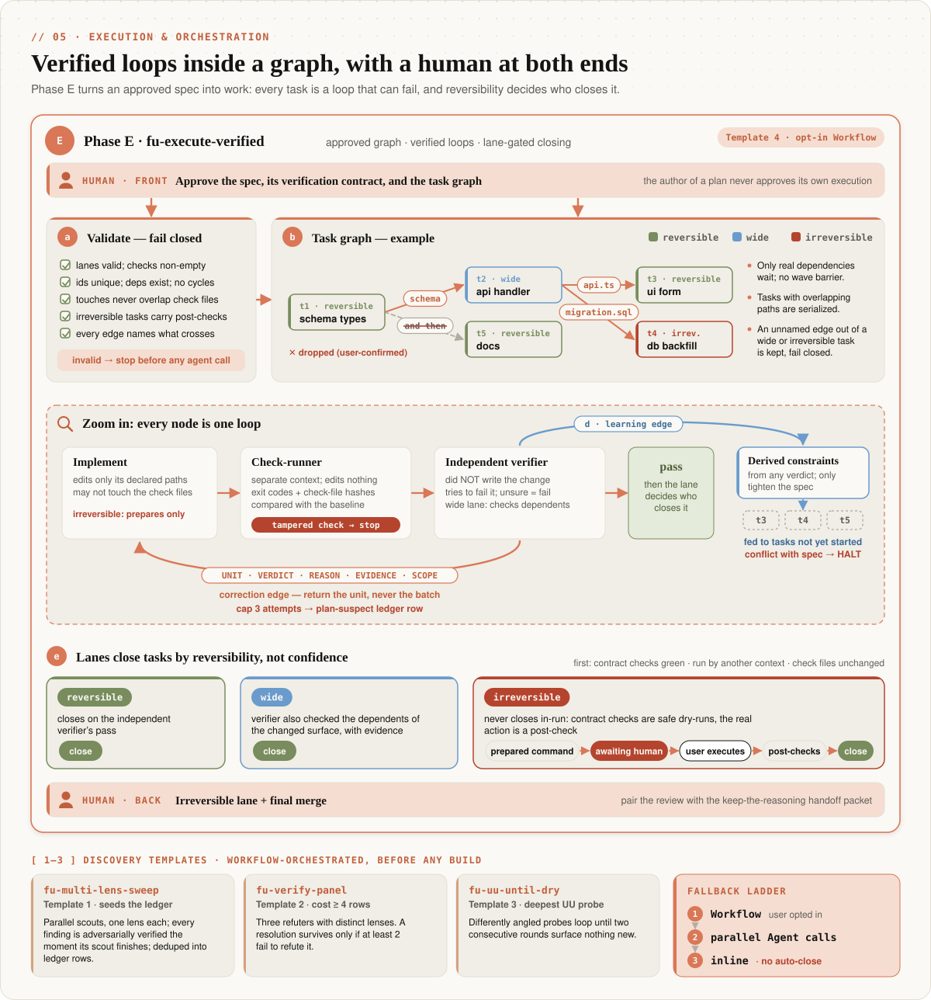
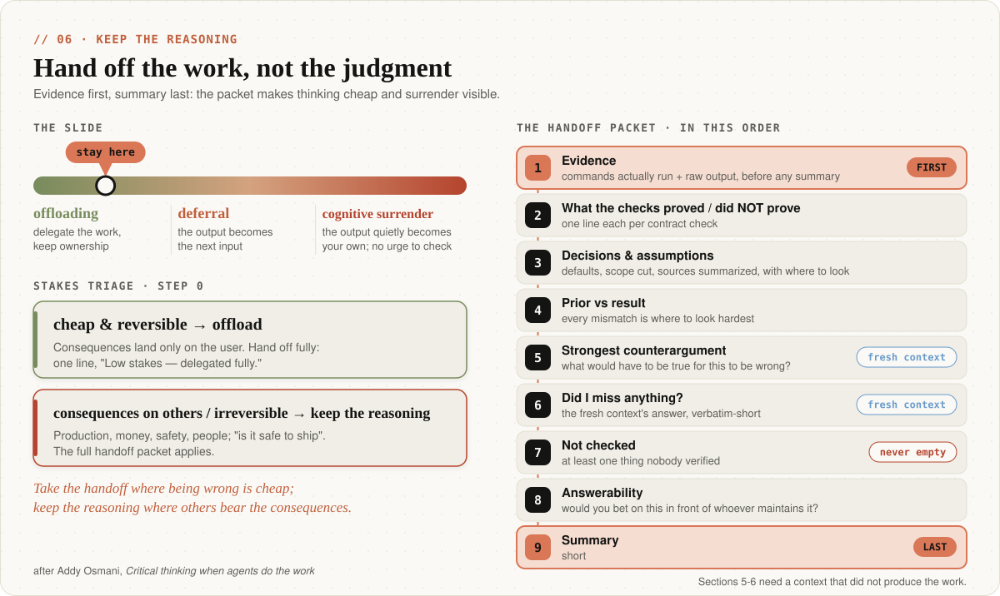

<p align="center">
  
</p>

<p align="center">
  
  
  
  
  
</p>

<p align="center"><strong>趁未知还便宜的时候把它挖出来——代理把活儿交回来时，判断权仍在你手里。</strong></p>

<p align="center">
  <a href="#-快速开始">快速开始</a> ·
  <a href="#-工作原理">工作原理</a> ·
  <a href="#架构">架构</a> ·
  <a href="#-演示">演示</a> ·
  <a href="README.md">English</a>
</p>

<p align="center"><em>本文是英文 README 的中文版；如有出入，以英文版为准。</em></p>

---

## ⚡ 速览

- **两个技能，覆盖完整生命周期。** `finding-unknowns` 负责在动手*之前和过程中*把你不知道的东西挖出来；`keep-the-reasoning` 负责*交接*那一刻——你验收代理成果时，判断仍由你来做。
- **按象限分诊，而不是凭习惯。** 每个未知先放进四象限地图定位，再由象限决定用八种轻量技术中的哪一种：盲点排查、原型、访谈、参考代码、计划、实施笔记、推介、测验。
- **高风险任务用 Cartographer 模式。** 按遗憾值排序的未知台账、每轮公开的分象限清晰度评分、七项条件的门控，以及需要审批才放行的执行桥接。不可逆的步骤一律交给你拍板。
- **纯 Markdown，零依赖。** 四个可选代理和 Workflow 脚本提供更大深度；没有它们，每种技术照样能在对话里直接跑。

## 💡 灵感来源

**地图不是疆域。** 地图是你交给 Claude 的东西——提示词、上下文、技能；疆域是工作真正发生的地方——代码库和现实世界。两者之间的落差由各种未知构成，每个未知都逼着模型去猜你的意图。长周期工作的瓶颈早已不是模型能力，而是清晰度。

常规的需求收集只会问"你想要什么？"——可没有人能回答自己意识不到的未知。不同类型的"不知道"需要不同的工具：盲区靠侦察，说不清的品味靠对原型做出反应，叫得出名字的缺口靠有针对性的提问，理解程度则靠考查。

> **来源说明。** 这些技术及其名称出自 Thariq Shihipar 的文章《_A Field Guide to Fable: Finding Your Unknowns_》（[@trq212](https://x.com/trq212/status/2073100352921215386)）。底层理念归功于原作者；本仓库只是把它们打包成可安装的 Claude Code 插件。

**交接难题。** 如今代理产出又快又"基本正确"，而基本正确的东西不会催你再看一眼。交接次数一多，人就会沿着一条光谱往下滑：**卸载**（offloading，把活儿交出去，但所有权还在自己手里）→ **顺从**（deferral，输出不再是待检验的假设，而直接成了下一步的输入）→ **认知投降**（cognitive surrender，输出悄悄变成了"你自己的"观点，你连检查的念头都没有）。代理式工作流默认没有任何东西会把你拉回来。`keep-the-reasoning` 就是那股反向的力，而且只在成本最低的时刻出手——它提炼自 Addy Osmani 的《_Critical thinking when agents do the work_》（[原文](https://x.com/addyosmani/status/2117512471930167377)）。

## 🛠 它能做什么

| 技能 | 覆盖阶段 | 你得到什么 |
|------|----------|------------|
| `finding-unknowns` | 动手之前与过程中 | 第 0 阶段象限分诊 → 八种技术 → 可选的 Cartographer 模式 |
| `keep-the-reasoning` | 交接环节 | 风险分级、事先定义"已验证"、固定顺序的交接包 |

`finding-unknowns` 在第 3 阶段结束时、以及 Cartographer 执行桥接结束时，把接力棒交给 `keep-the-reasoning`。

<p align="center">
  
</p>

**先给未知定位。** 第 0 阶段是阻塞性的：先判断缺口落在哪个象限，用一句话记下你的先验预期，宣布分诊路线，然后才运行任何技术。

<p align="center">
  
</p>

| 阶段 | 技术 | 象限 | 适用场景 |
|------|------|------|----------|
| 事前 | 1 · 盲点排查 | UU | 进入陌生领域或代码库时的未知未知 |
| 事前 | 2 · 头脑风暴与原型 | UK | "看到了我就知道" |
| 事前 | 3 · 访谈 | KU | 叫得出名字的缺口——每轮最多 3 个相互独立的问题；彼此依赖的问题留到下一轮 |
| 事前 | 4 · 参考代码 | UK | 说不清楚时，直接指向现成代码 |
| 事前 | 5 · 实施计划 | KU | 先摆出改起来最贵的决策，并定义何为"已验证" |
| 事中 | 6 · 实施笔记 | — | 偏离计划之处与边界情况，发生时当场记录 |
| 事后 | 7 · 推介与说明 | — | 争取认可与审批 |
| 事后 | 8 · 测验 | UU（事后） | 合并前检验你是否真正理解了改动 |

已知的已知（KK）只需趁它还没走样时写下来。各技术的完整流程见 [`SKILL.md`](skills/finding-unknowns/SKILL.md)。

**Cartographer 模式**——面向高风险工作的严格升级版。疆域没摸清之前，它不放行任何实现工作。

- **未知台账**——每一行记录象限、先验、`遗憾值 = 出错代价 × 出错概率`、**路由**（访谈 · 疆域核查 · 实验 · 审计）和**可逆性**（可逆 · 影响面广 · 不可逆）。台账*本身*就是断点续跑的状态。
- **是路由器，不是访谈**——每轮按路由清理遗憾值最高的未关闭行。能在疆域里查到的问题，绝不拿去问用户。
- **清晰度看得见**——每轮都给四个象限重新打分：`ambiguity = 1 − (KK×0.20 + KU×0.25 + UK×0.25 + UU×0.30)`，默认阈值 0.25。
- **双重门控**——覆盖度（每个象限都探查过）与清晰度同时达标，外加不可逆性底线。门控通过后，产出一份待审批的规格说明，附带验证契约。

**keep-the-reasoning**——验收环节的协议。

- **先做风险分级**——`offload`（错了代价小、可撤回、后果只落在你自己身上）还是 `keep-the-reasoning`（后果落在别人身上、难以撤回）。
- **先有假设再提问；先定义"已验证"再动手**——检查必须是可能失败的。"模型很有把握"不算检查。
- **固定顺序的交接包**——证据在最前，然后是每项检查证明了什么、*没有*证明什么，决策与假设，先验与结果的对照，来自全新上下文的反方论证，永不为空的"未检查项"，摘要放最后。
- **交接之后**——每一次驳回都沉淀成规则（测试、hook 或 lint 规则）；出现"投降信号"时只点明一次，不说教。

## 🚀 快速开始

**环境要求：** Claude Code（命令行、桌面应用或 IDE 扩展均可）。无运行时、无依赖——技能、代理和命令都是纯 Markdown。只有 `install.sh` 需要 `bash`。

**A — 插件市场（推荐）**

```
/plugin marketplace add baizhiyuan/finding-unknowns-skill
/plugin install finding-unknowns@finding-unknowns-skill
```

**B — 克隆后安装**（两个技能、`references/`、四个代理和全部斜杠命令）

```bash
git clone https://github.com/baizhiyuan/finding-unknowns-skill.git
cd finding-unknowns-skill && bash install.sh
```

**C — 被动接入，无需安装。** 把 [`CLAUDE.md`](CLAUDE.md) 复制到项目根目录，即可获得轻量、常驻的引导。

<details>
<summary><b>D — 手动复制</b></summary>

```bash
mkdir -p ~/.claude/skills/finding-unknowns/references ~/.claude/skills/keep-the-reasoning
cp skills/finding-unknowns/SKILL.md ~/.claude/skills/finding-unknowns/
cp skills/finding-unknowns/references/*.md ~/.claude/skills/finding-unknowns/references/
cp skills/keep-the-reasoning/SKILL.md ~/.claude/skills/keep-the-reasoning/
```

</details>

### 60 秒上手

```
/finding-unknowns <任务>             # 第 0 阶段：给未知定位、宣布路线、运行对应技术
/blindspot <目标或领域>              # 只读侦察：雷区、隐藏背景、专家会问的问题
/cartographer --deep <任务>          # 高风险：台账、计分的清理循环、双重门控、执行桥接
/change-quiz [diff 范围]             # 变更报告 + 合并前必须通过的理解测验
/keep-the-reasoning [成果或决策]     # 风险分级，然后给出证据优先的交接包
```

没装插件？通过 Skill 工具调用 `finding-unknowns` 技能，或者直接说：_"做一次盲点排查"_、_"来访谈我"_、_"给我四个方向"_。[`EXAMPLES.md`](EXAMPLES.md) 里有可直接复制的提示词。

<details>
<summary><b>配置（可选——默认零配置）</b></summary>

**清晰度阈值。** Cartographer 的加权歧义门控默认是 `0.25`。可在 `.claude/settings.json` 中按项目或按用户覆盖（项目级优先于用户级）；进入 Cartographer 时会先报出最终生效的阈值及其来源。

```json
{ "findingUnknowns": { "ambiguityThreshold": 0.25 } }
```

**深度预设。** 命令上的标志优先于任何设置。

| 标志 | 阈值 | 适用于 |
|------|------|--------|
| `/cartographer --quick <task>` | 0.35 | 快速摸底、风险较低的工作 |
| `/cartographer --standard <task>` | 0.25（默认） | 大多数任务 |
| `/cartographer --deep <task>` | 0.15 | 高风险、难以撤回的工作 |

**其他默认值**——原型方向数（4）、遗憾值提问门槛（1.0，对不可逆行永不适用）、测验题量与轮数、Cartographer 轮次上限（软上限 10 / 硬上限 20）、执行重试上限（3）——都在 [`SKILL.md`](skills/finding-unknowns/SKILL.md) 的 **Defaults** 表里，可用自然语言随时覆盖。

</details>

## 🎬 演示

> _以下为示意性记录，按两个 `SKILL.md` 和 `references/cartographer.md` 中的输出模板编写（保留模板原文的英文格式），并非真实会话录屏。_

**1 · 第 0 阶段分诊**——在任何技术运行之前宣布，你可以当场否决。

```
> /finding-unknowns add a usage dashboard to the admin app

Prior: "a few charts over the existing usage table"
Routing: UU + UK → blind-spot pass, then 4-direction prototype — you're new to this
subsystem (UU) and the dashboard layout is know-it-when-you-see-it (UK).
```

**2 · 一轮 Cartographer 报告**——每轮都亮出评分和七项门控条件，让你随时掌舵，而不是到最后才发现跑偏。

```
Round 3 complete.

Ledger: 4 open | 1 probing | 6 resolved | 2 deferred
Top regret: U2 (2.0) — which auth path to extend [route: interview]

| Quadrant      | Score   | Weight        | Gap                                        |
|---------------|---------|---------------|--------------------------------------------|
| KK            | 0.90    | 0.20          | clear                                      |
| KU            | 0.50    | 0.25          | auth path (U2) undecided                   |
| UK            | 0.70    | 0.25          | session-UX criteria not yet confirmed      |
| UU            | 0.70    | 0.30          | two scout lenses run; not yet dry          |
| **Ambiguity** | **31%** | threshold 25% | KU × auth middleware — U2 sets the design  |

Coverage gate:
[x] KK locked          [ ] KU resolved/deferred
[x] UK extracted       [x] UU probed
[ ] no open row with regret ≥ 1.0
[x] every irreversible row user-confirmed
[ ] ambiguity 31% ≤ threshold 25%

Next target: U2 — highest-regret open row; a wrong guess forces a rewrite of the
middleware layer.
```

**3 · 一份 keep-the-reasoning 交接包**——证据在前，检查的局限写明，摘要殿后。

```
Handoff lane: keep-the-reasoning — schema migration on a shared production table.
1. Evidence: `pytest tests/migrations -q` → 14 passed; `alembic upgrade head --sql` →
   plan at artifacts/upgrade.sql (ALTER + backfill, 2 statements)
2. Proved: upgrade SQL applies cleanly to an empty schema. NOT proved: runtime on the
   41M-row table; lock behaviour under write load. Tests written in this session.
3. Decisions: backfill default = 'unknown' (spec silent); downgrade drops the column
   (data loss) — see migrations/0042.py:31
4. Your prior: "a quick additive change". Mismatch: the backfill rewrites every row.
5. Counterargument (fresh subagent): if writes continue during backfill, the table lock
   stalls checkout. Not checked.
6. Missed: the replica lag alert threshold.
7. Not checked: lock duration at production size; replica lag.
8. Would you bet on this in front of the on-call? If not: run it on the staging snapshot.
9. Summary: migration is correct on small data; production behaviour unverified.
```

它要取代的反面做法是：_"Done! The migration is ready and all tests pass ✅."_

## 🏗 工作原理

### 架构

**命令负责分发，技能负责决策，代理负责执行，文档负责持久化。** 每个技能的流程只在一处定义——它的 `SKILL.md`；Cartographer 的规范性协议在 [`references/cartographer.md`](skills/finding-unknowns/references/cartographer.md)，按需读取。每种技术都能独立运行，命令和代理只是增强，而非依赖。完整设计说明见 [docs/ARCHITECTURE.md](docs/ARCHITECTURE.md)。

<p align="center">
  
</p>

| 层 | 内容 | 职责 |
|----|------|------|
| 命令 | `/finding-unknowns` `/blindspot` `/cartographer` `/change-quiz` `/keep-the-reasoning` | 薄入口：指明技能章节、传入参数 |
| 技能 | `finding-unknowns`、`keep-the-reasoning` | 协议本体：分诊、技术、Cartographer、护栏；交接 |
| 代理 | 四个专职代理 | 相互隔离的执行配置，输入输出契约明确 |
| 产物 | 台账、规格说明、笔记、原型、报告 | 持久化状态；台账是续跑的锚点 |
| 参考 | `cartographer.md`、`workflows.md` | Cartographer 完整协议；可选的 Workflow 脚本及降级阶梯 |

**发现、打分和考查，永远不由负责实现的那个上下文来做。** 不能改文件的侦察兵，就不会顺手开工；没主持访谈的记账员，就不会给门控结论注水；没写这份 diff 的考官，问得才够狠。

| 代理 | 模型 | 工具 | 支撑 | 为何隔离 |
|------|------|------|------|----------|
| `blindspot-scout` | sonnet | 只读 | 盲点排查、参考代码 | 在独立上下文里大范围侦察；结构上就无法动手实现 |
| `prototype-smith` | inherit | 只写一次性文件 | 原型、计划 | 一次产出 N 个真正不同的方向，与真实应用隔离 |
| `ledger-keeper` | inherit | 仅限台账文件 | Cartographer | 遗憾值、清晰度评分与门控裁决——不给自己主持的访谈打分 |
| `quiz-master` | inherit | 只读 + 报告 | 推介、测验 | 没写过这次改动的"新鲜眼睛"考官；会标出未记录的偏离 |

**模型路由。** 负责判断和创意的代理使用 `model: inherit`，跟随会话当前的模型强度，绝不降级。`blindspot-scout` 是唯一刻意压低成本的一档（`sonnet`），因为侦察要并行扇出；做单视角排查时可改为 `inherit`。这套方案参照了 OMC 的角色分档，以及 Deep Research"最强模型坐镇综合中心、廉价模型负责扇出"的做法——区别在于顶档是继承而来，而非写死。

### Cartographer 全流程

<p align="center">
  
</p>

宣布阈值 → 第 0 轮确认拓扑（1–6 个组件）→ **C0** 从四个象限加领域清单为台账播种 → **C1** 按路由清理，代价 ≥ 4 的结论先做对抗性验证，每轮重新打分 → **C2** 双重门控 + 完整性审查 → **C2.5** 收尾报告与固化的规格说明 → **E** 需审批的执行桥接（独立规划者与评审者达成共识，或交给 Workflow 执行）→ **C3** 台账在整个构建期间保持打开，并作为测验的出题依据。

**v4.0.0 新增**

- **不可逆性底线。** 遗憾值里乘了出错概率——而那本质上是一个置信度估计。对 `irreversible` 行，置信度永远不能代替用户：不会因为低于遗憾值门槛就被悄悄采用默认值，只有记录了用户确认才算解决。这是门控的第七项条件，任何提前退出都不能豁免。
- **先验与意外。** 每一行在按证据打分前，先记下当时的预期；与之矛盾的发现会作为"意外"单独呈现，而不是被悄悄消化掉。
- **验证契约。** 固化的规格说明为每条验收标准列出：一个可能失败的检查、它的产物、它证明了什么、*没有*证明什么，以及所属通道——并对实现者锁定，实现者无权修改。
- **E 阶段执行规则。** 循环在任务内部，图在任务之间。边必须写明传递的是什么；失败按 `UNIT · VERDICT · REASON · EVIDENCE · SCOPE` 逐单元返回；重试达到上限后，任务会变成一条"计划存疑"的台账行；学习边把推导出的约束传给尚未开始的任务；任务按可逆性通道关闭，依据的是独立检查执行者给出的结果。人站在两端——前端是规格说明、契约和任务图，后端是不可逆通道和合并。

### Workflow 编排

当宿主提供 Claude Code 的 **Workflow 工具**、且你选择启用时，扇出密集的操作会以确定性脚本运行，脚本见 [`references/workflows.md`](skills/finding-unknowns/references/workflows.md)：

<p align="center">
  
</p>

| 脚本 | 作用 |
|------|------|
| `fu-multi-lens-sweep` | 多个视角的侦察并行展开；每个视角一完成，其发现立即接受对抗性验证（无屏障）；输出经 schema 校验的台账行 |
| `fu-verify-panel` | 对代价 ≥ 4 的结论组织三位反驳者（替代解释 / 证据独立性 / 可复现性） |
| `fu-uu-until-dry` | UU 探查循环，连续两轮没有新发现才停——以信息量为界，而不是固定轮数 |
| `fu-execute-verified` | 按 E 阶段规则执行已批准的任务：每个实现者都配一位独立的、以反驳为目标的验证者 |

**降级阶梯：** Workflow → 并行 Agent 调用 → 完全内联。逻辑是硬性规范，机制不是。如果执行时完全没有子代理，实现者和验证者就会是同一个上下文，因此没有任何通道会自动关闭——每个任务都以 `awaiting-human` 的状态交给你。

**哪些靠代码强制、哪些靠提示词——如实说明。** 在 `fu-execute-verified` 中，由代码强制的有：参数校验失败即关闭（fail closed）、边不会被悄悄丢弃、按任务调度、路径锁、按通道关闭任务，以及把检查结果和检查文件哈希与运行前基线比对。仍然*依赖提示词*的有：检查执行者的报告本身、实现者不执行不可逆操作、检查执行者拒绝运行不可逆检查。验证者的独立性则由结构保证。

### 交接环节

<p align="center">
  
</p>

干活的代理无权宣布自己的活儿已被验收。如果之前已经跑过 `finding-unknowns`，`keep-the-reasoning` 会直接复用其中的先验、验证契约，以及 quiz-master 报告里的"决策与假设"，不再重复一遍。

## 🧗 我们遇到的挑战

- **访谈用错了工具。** 在一次真实的实地测试中（量化 × 深度学习研究任务），遗憾值最高的三个未知全都不该靠访谈解决。于是 Cartographer 的循环改成了带 `route` 列的路由器：疆域里查得到的行绝不问用户，等待实验结果的行会让循环暂停，而不是空转出新的轮次。（v3.3.0）
- **结果漂亮不等于问题已解决。** 一个很强的 RankIC 结果看似回答了"信号是真的吗？"——但数据泄漏也能产生同样的 IC。如今代价 ≥ 4 的行必须先通过对抗性检查、并有两个独立来源，才算真正解决。（v3.4.0）
- **用户看不见模型有多确定。** 第二次实地测试中，发现环节表现很好，但工作逐渐滑进一片用户无从掌舵的模糊地带。解法：每轮公开分象限的清晰度评分；评分在单次调用中完成、只依据台账证据，并把"评分漂移"列为明确的失败模式。（v3.6.0）
- **置信度与影响范围之争。** 遗憾值要乘以出错概率——而这正是最容易过度乐观的输入——于是一个自信的代理可能悄悄给不可逆的步骤套上默认值。v4 加入不可逆性底线：按影响范围把关，而不是按置信度。
- **我们自己的执行器曾经"失败即放行"。** 一次独立的对抗性评审在 `fu-execute-verified` 中发现了 1 个 CRITICAL 和 6 个 HIGH 问题，并在模拟运行时中复现——其中包括参数校验会放过未知或缺失的通道（lane）。现在校验一律失败即关闭，检查文件一旦被篡改，任务立即停止，越出声明路径的写入会中止整个运行。经过三轮评审，这些修复由一套针对模拟代理运行时的 50 场景测试集覆盖。
- **对听起来不错的建议说"不"。** "只审批最后一步"被刻意没有采纳——一个人如果只审最终产物、却从没参与过框定问题，那就是橡皮图章。

## 🧩 横向对比

`finding-unknowns` 是一个轻量的定向层，不是执行引擎。这些工具是互补的：先用它给未知定位，再升级到合适的专门工具。

| 维度 | finding-unknowns | Deep Interview（[OMC](https://github.com/Yeachan-Heo/oh-my-claudecode)） | OMC 执行（autopilot / ralph / team） | [Superpowers](https://github.com/obra/superpowers) |
|------|------------------|------------------------|----------------------|-----------------------|
| 所处层级 | 元层 / 定向 | 单一阶段：需求 | 执行与交付 | 规范化原语 |
| 生命周期 | 事前 · 事中 · 事后 | 仅事前 | 事中 · 事后 | 多为单一阶段 |
| 严谨度 | 灵活 | 歧义门控 | 验证门控 | 清单驱动 |
| 状态 | 无状态（Cartographer：台账文件） | 持久化、可续跑 | 持久化、多代理 | 视情况而定 |
| 最适合 | 你还不知道自己的未知是什么 | 需要一份经过验证的规格说明 | 规格说明已经清楚 | 只需要一个有章法的动作 |

Deep Interview（以 OMC 5.8.1 为准）需经审批才放行；它的 `--frontier` 模式是与"批量独立提问 + 疆域路由"最接近的对应物。Cartographer *借用了*它的透明化机制——带阈值的清晰度评分、第 0 轮拓扑、挑战模式——同时保留了单靠清晰度评分访谈无法覆盖的那几个维度。

<details>
<summary><b>Cartographer 与 Deep Interview 逐项对比</b></summary>

| 维度 | Deep Interview | Cartographer 模式 |
|------|----------------|-------------------|
| 门控标准 | 歧义 ≤ 阈值（目标/约束/标准三个维度） | 双重：覆盖度（四个象限都探查过，必须跑过盲点排查）且分象限加权歧义 ≤ 阈值，外加不可逆性底线 |
| 盲区（UU） | 未建模 | 一等公民；权重最高（0.30） |
| 生命周期 | 止于规格说明 | 一份台账：事前播种、事中追加、事后关闭 |
| 优先级 | 固定的维度权重 | 遗憾值给行排序；歧义给象限打分 |
| 清理手段 | 苏格拉底式问答 | 按每个未知分派路由：访谈 / 疆域核查 / 实验 / 审计 |
| 执行 | 经审批后交接进入 OMC 流水线 | 需审批的桥接：规划者 + 评审者达成共识，或由 Workflow 执行并对每个任务做反驳式验证 |

```
finding-unknowns  （定向：这个未知落在哪个象限？）
        ├─ 轻量的重新审视就够了          → 八种技术
        ├─ 高风险，需要覆盖度门控        → Cartographer 模式
        ├─ 需要歧义门控 + 可续跑的状态    → OMC Deep Interview
        ├─ 发散地生成备选方案            → superpowers:brainstorming
        ├─ 一份严谨的书面计划            → superpowers:writing-plans / omc-plan
        ├─ 规格说明已经很具体            → OMC autopilot / ralph / team
        └─ 活儿干完了，风险在交接        → keep-the-reasoning
```

</details>

**能委托就不重造。** 装了对应的姊妹工具时，`finding-unknowns` 会把它擅长的机制交给它，自己只守住"未知"这个视角——象限分诊、按遗憾值定价的台账行、按路由清理、可逆性底线、贯穿生命周期的持久化。

| 需求 | 姊妹工具（已安装时） |
|------|----------------------|
| 验收代理产出而不交出判断 | `keep-the-reasoning`（本仓库） |
| 本体追踪、OMC 状态、交接给 ralplan/autopilot | `oh-my-claudecode:deep-interview` |
| 迷雾测试，以及在任务跟踪系统里开决策工单 | `oh-my-claudecode:ask-navigator` |
| 对 diff 或设计做对抗性评审 | `oh-my-claudecode:interrogate` |
| 用一次性原型敲定设计 | `oh-my-claudecode:loft` |
| 自主运行的决策轨迹 | `oh-my-claudecode:show-me-your-work` |
| 证明一项改动的影响范围 | `oh-my-claudecode:blast-radius` |
| 开工前复述需求 | `oh-my-claudecode:in-your-own-words` / `sharpen` |
| 按学习者节奏讲解 | `oh-my-claudecode:teach` |

## 🔭 下一步

尚未完成的事，照实列出：

- **在真实的 Workflow 运行时里跑 `fu-execute-verified`。** 到目前为止，它只在模拟的代理运行时上验证过。
- **在运行时允许的范围内，把剩下靠提示词保证的部分挪进代码**——目前检查执行者的报告和"拒绝不可逆操作"仍依赖提示词。
- **中文版示意图。** 本中文 README 目前沿用英文 SVG。
- **本体 / 实体收敛追踪**——在 v3.6.0 中有意推迟，因为第 0 轮拓扑门控能以更低成本满足收敛需求；若测试中出现组件漂移，再重新评估。

## 📁 项目结构

<details>
<summary><b>仓库目录树</b></summary>

```
finding-unknowns-skill/
├── .claude-plugin/          插件与插件市场清单（/plugin install）
├── commands/                斜杠命令入口（薄分发层）
│   ├── finding-unknowns.md    /finding-unknowns —— 第 0 阶段分诊
│   ├── blindspot.md           /blindspot —— 盲点排查
│   ├── cartographer.md        /cartographer —— Cartographer 模式
│   ├── change-quiz.md         /change-quiz —— 报告 + 合并测验
│   └── keep-the-reasoning.md  /keep-the-reasoning —— 交接
├── skills/
│   ├── finding-unknowns/
│   │   ├── SKILL.md         分诊、八种技术、Cartographer 摘要
│   │   └── references/
│   │       ├── cartographer.md  Cartographer 完整协议（规范性），按需读取
│   │       └── workflows.md     Workflow 模板 + 降级阶梯
│   └── keep-the-reasoning/
│       └── SKILL.md         风险分级、交接包
├── agents/                  blindspot-scout（sonnet）· prototype-smith · ledger-keeper · quiz-master（inherit）
├── docs/ARCHITECTURE.md     设计参考：分层、契约、原则
├── assets/                  README 示意图（SVG）
├── AGENTS.md                面向编码代理与贡献者的仓库指南
├── EXAMPLES.md              可直接复制的端到端提示词
├── CLAUDE.md                被动接入用的单文件版本
├── install.sh               安装脚本（技能 + references + 代理 + 命令）
├── CONTRIBUTING.md · CHANGELOG.md · LICENSE（MIT）
└── README.md（英文，权威版本）· README.zh.md（简体中文）
```

</details>

## 🔄 更新

用当初的安装方式来更新即可。最新版本为 **v4.0.0**。

```
/plugin marketplace update finding-unknowns-skill
/plugin update finding-unknowns@finding-unknowns-skill
```

<details>
<summary><b>克隆安装、手动复制与版本核对</b></summary>

**方式 B**——`install.sh` 会原地覆盖，所以它本身就是更新脚本：

```bash
cd finding-unknowns-skill && git pull origin main && bash install.sh
```

**方式 D**——覆盖同样的文件。`references/` 里有 Cartographer 协议和 Workflow 模板，也必须一并更新；v4 还新增了 `keep-the-reasoning` 技能。

```bash
cd finding-unknowns-skill && git pull origin main
mkdir -p ~/.claude/skills/finding-unknowns/references ~/.claude/skills/keep-the-reasoning
cp skills/finding-unknowns/SKILL.md ~/.claude/skills/finding-unknowns/
cp skills/finding-unknowns/references/*.md ~/.claude/skills/finding-unknowns/references/
cp skills/keep-the-reasoning/SKILL.md ~/.claude/skills/keep-the-reasoning/
cp agents/*.md   ~/.claude/agents/
cp commands/*.md ~/.claude/commands/
```

**核对已安装的版本：**

```bash
grep '"version"' ~/.claude/plugins/*/finding-unknowns*/.claude-plugin/plugin.json 2>/dev/null \
  || ls ~/.claude/skills/finding-unknowns/references/cartographer.md ~/.claude/skills/keep-the-reasoning/SKILL.md
# 预期：4.0.0（插件方式）——或两个文件都被列出（它们从 v4.0.0 起才存在）
```

</details>

## 🤝 参与贡献

欢迎各种贡献——新技术、提示词打磨、文档、示意图。流程与本地校验见 [CONTRIBUTING.md](CONTRIBUTING.md)，仓库的不变约束见 [AGENTS.md](AGENTS.md)。

## 🙏 致谢与许可

- 技术理念与名称：Thariq Shihipar，《_A Field Guide to Fable: Finding Your Unknowns_》（[@trq212](https://x.com/trq212/status/2073100352921215386)）。
- `keep-the-reasoning` 与验证契约：Addy Osmani，《_Critical thinking when agents do the work_》（[原文](https://x.com/addyosmani/status/2117512471930167377)）。
- E 阶段执行规则：Anthropic 的《_Building effective agents_》（evaluator-optimizer、orchestrator-workers）与 @hanakoxbt 的《_Loops and Graphs_》（[原文](https://x.com/hanakoxbt/status/2091515787366306154)）。
- Cartographer 的歧义门控、拓扑门控与挑战模式改编自 [oh-my-claudecode](https://github.com/Yeachan-Heo/oh-my-claudecode) 中的 deep-interview 技能；对比部分还参考了 [Superpowers](https://github.com/obra/superpowers)。

以 [MIT 许可证](LICENSE) 发布。

**免责声明。** 本项目是独立的社区项目，与 Anthropic 无任何隶属关系，也未获其授权或背书。
