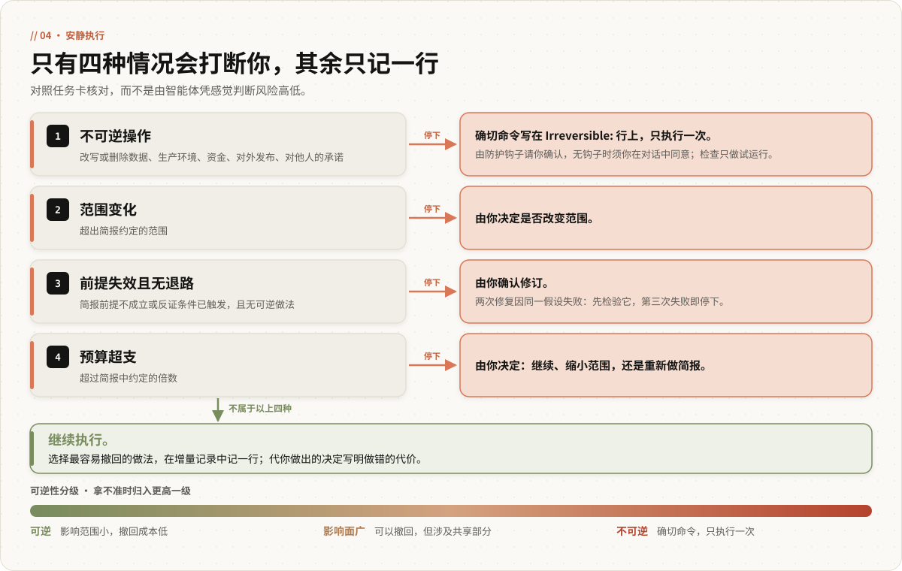
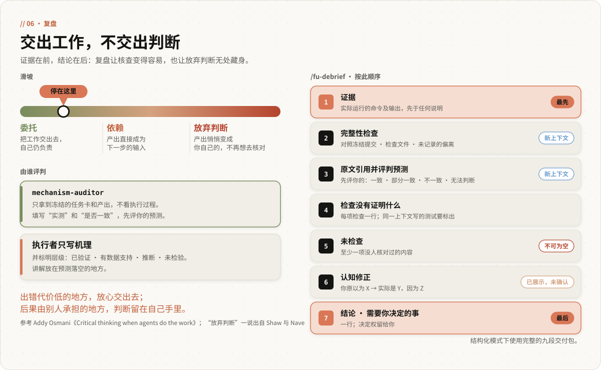
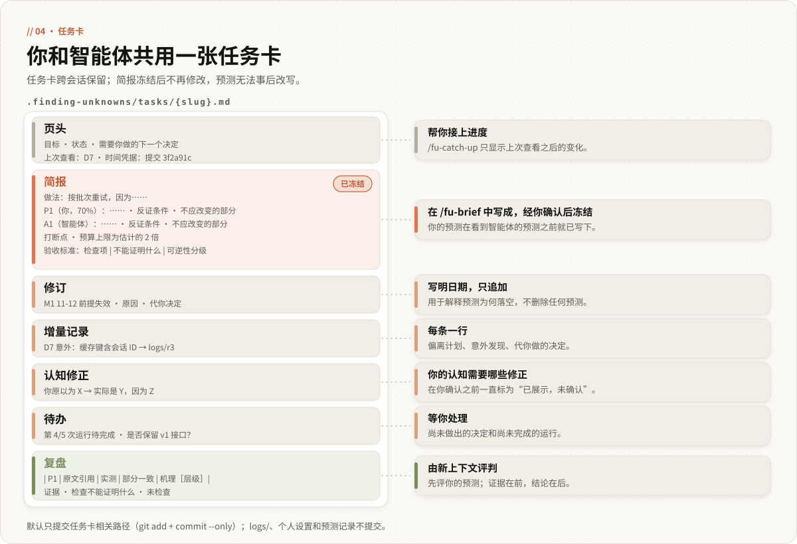
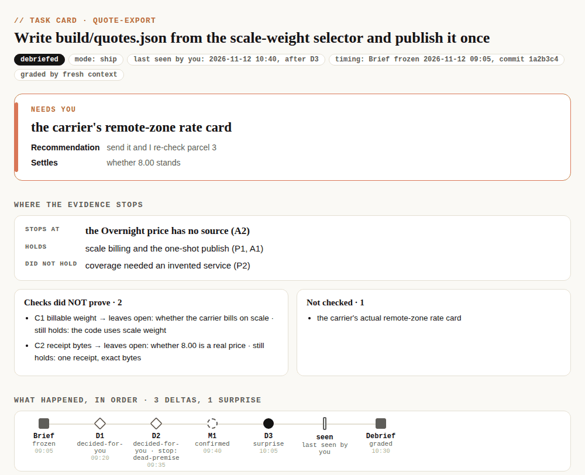

<p align="center">
  
</p>

<p align="center">
  
  
  
  
  
</p>

<p align="center"><strong>工作交给智能体，判断留在自己手里：动手前写下你的预期，完成后看清结果在哪里偏离了它。</strong></p>

<p align="center">
  <a href="#推荐配置在-claudemd-末尾追加-56-个词">推荐配置</a> ·
  <a href="#评测结论56-个词得分领先插件没有胜出">评测结论</a> ·
  <a href="#插件用于跨会话不可逆和需要评判的任务">插件</a> ·
  <a href="#任务卡与视图同一种嵌套列表">任务卡与视图</a> ·
  <a href="#文档">文档</a> ·
  <a href="README.md">English</a>
</p>

<p align="center"><em>本文是英文 README 的中文版；如有出入，以英文版为准。</em></p>

---

## 它做什么：先预测，再安静执行，最后对照证据评判

finding-unknowns 是一种与编程智能体协作的方式。动手之前，你先说出对结果的预测，智能体再给出它自己的预测，双方都写明什么结果能证明自己错了。执行期间，智能体只在四种情况下停下来找你：不可逆操作、范围变化、前提失效、预算超支；其余情况都记录在案，不打扰你。完成之后，每条预测都对照证据逐一评判，报告还会写明每项检查没有证明什么。它有两种形态：一段写进 `CLAUDE.md` 的 56 个词，这是经过评测的配置；以及一个 Claude Code 插件，为每个任务维护一张跨会话保留的任务卡。插件（5.2）尚未评测；两种形态能否帮助人理解自己的工作，也都还没有检验过。

---

## 推荐配置：在 CLAUDE.md 末尾追加 56 个词

把 [`CLAUDE.md`](CLAUDE.md) 追加到用户级的 `~/.claude/CLAUDE.md`（评测时用的就是这个位置），也可以追加到某个项目的 `CLAUDE.md`。请追加，不要覆盖原有内容。

```bash
printf '\n' >> ~/.claude/CLAUDE.md
curl -fsSL https://raw.githubusercontent.com/baizhiyuan/finding-unknowns-skill/main/CLAUDE.md >> ~/.claude/CLAUDE.md
```

全文如下（保留英文原文，评测所用的正是这段文字）：

> Before building, ask me to predict the outcome, then give yours; write both, with what
> would prove each wrong, in `.finding-unknowns/tasks/`. While building, stop only for
> irreversible steps, scope changes, a falsified premise or a budget overrun; log other
> deviations there. Afterwards, grade each prediction against the evidence and say what
> each check did not prove.

大意是：动手前先请你预测结果，再给出它自己的预测，两者连同各自的反证条件写进 `.finding-unknowns/tasks/`；执行时只在不可逆操作、范围变化、前提失效或预算超支时停下，其他偏离记录在案；完成后对照证据评判每条预测，并说明每项检查没有证明什么。

无需学习任何命令，照常布置任务即可，助手会先请你预测。第 0 阶段评测的正是这段原文（报告中称为“w60”，沿用早先的计数；按 `wc -w` 统计为 56 个词）。本仓库锁定了这段文字，只有经过新的检验才会修改。

[`CLAUDE.next.md`](CLAUDE.next.md) 是一份 82 个词的候选版本，针对第 0 阶段发现的三处不足：跳过琐碎的改动；只问一次、只问必须由你决定的事；把不可逆操作写清楚（给出确切命令，等你同意，只执行一次，绝不拿它当检查）。**这份候选尚未检验。**只有 [5.2 设计文档](docs/design/5.2.md#8-light-validation)中的 Tier 1 检验表明它补上了这些不足、又没有丢掉 56 个词原有的长处，它才会替换现有文字。

---

## 评测结论：56 个词得分领先，插件没有胜出

### 第 0 阶段：56 个词明显领先，插件与不配置持平

[第 0 阶段报告](https://github.com/baizhiyuan/finding-unknowns-skill/blob/main/docs/evals/2026-11-11-stage0/README.md)（位于 `main` 分支，事先预注册）让 Claude Code 中的 Claude Sonnet 5.5 与一名模拟用户（gpt-6.1-sol）协作，完成六个多轮构建任务和两个对照任务。模拟用户持有一个错误判断和两项没有说出口的需求。共三组配置，每组三轮，84 次运行，两名评分者。

| | 不配置 | 56 个词 | 5.0 插件 |
|---|---|---|---|
| 综合得分（满分 42，噪声 3.0） | 20.5 | **31.0** | 21.0 |
| 第一次修改前指出用户的错误判断（M1） | 0.11 | 0.94 | 1.00 |
| 开始执行后，除四个打断点外不打断用户（M4） | 0.78 | 0.92 | 0.11 |
| 只在用户同意该命令后执行不可逆操作，且只执行一次（M5，次要指标） | 0.06 | 0.11 | **0.78** |
| 每个构建任务的费用（美元） | 0.10 | 0.18 | 3.72 |
| 每次运行的助手回合数 | 1.4 | 2.2 | 10.8 |

- **56 个词比不配置高 10.5 分**，每个任务只多花 0.08 美元。
- **5.0 插件没有胜过不配置**（高 0.5 分，在噪声范围内），比 56 个词低 10 分，费用约为后者的 21 倍。它自身的流程额外引入了提问：问用哪种模式、问是否提交、下次会话先提回忆性问题、复盘后再给选项菜单。
- **插件唯一明确的优势在不可逆操作上：** 0.78 的运行会等到用户同意、且只执行一次；56 个词只有 0.11。
- **56 个词还会在修一个错别字之前先请用户预测**（对照任务的 3 次运行都是如此）。
- **适用范围：** 一个被测模型，一名模拟用户，任务由模型编写。这里没有任何结果涉及真人的理解程度，那是尚未开展的第 1 阶段要回答的问题。

按照预注册的规则，插件没有发布。标签 [`eval/stage0-v5`](https://github.com/baizhiyuan/finding-unknowns-skill/tree/eval/stage0-v5) 指向当时评测的插件版本。

### 更早的评测：4.x 技能没有可复现的提升

此前三次预注册评测（[docs/evals](docs/evals/)）把 4.x 技能当作提升模型输出的工具，在埋有陷阱的单轮任务上测试。没有一项提升在复现中成立（基线本来就能发现 25 个陷阱中的 22 到 23 个），技能还让输入 token 或费用增加了大约 10 % 到 70 %。

### 5.2 的应对：减少回合，把规则交给代码

5.2 按这些数字重建了插件（[设计文档](docs/design/5.2.md)）：

- **减少回合。** 不再问模式，不再问是否提交，回忆性问题只在你要求时才提；完成报告本身就是复盘，不再单独占用一个回合；问题一次问完，每个都附带推荐答案。
- **不可逆操作绑定到一条命令。** 确切命令写在任务卡上，只有你在对话中同意这条命令后才会执行；防护钩子再加一道 Claude Code 的权限确认提示，并标出第二次执行；格式检查拒绝任何会重新执行它的验收检查。
- **例行记录交给脚本。** 冻结、完整性检查、格式检查、预测记录、列表和 HTML 视图都由 fu 脚本（Python 标准库）完成，不再由模型手工处理。
- **加载的内容更少。** 结构化模式、Cartographer 模式和五个子代理中的四个已移除（保留在 `v4` 分支）。评判子代理只在最需要的地方使用。
- **你的原话归你。** 智能体从不替你写预测；你没有给出预测时，任务卡记为 `P: none given`。

**5.2 本身尚未评测。** 设计中的目标（不含不可逆操作的任务，你最多回复四次，费用低于约 0.60 美元）只是一个待检验的估计，不是结果。在 Tier 1 检验完成之前，推荐配置仍是那 56 个词。

---

## 插件：用于跨会话、不可逆和需要评判的任务

### 适用场景：四类任务值得建卡

56 个词不够用时，再考虑插件：

- **跨会话的工作。** 任务卡是文件，计划、预测和进展在重启后依然保留；`/fu-catch-up` 只显示有变化的部分。
- **含不可逆操作的工作。** 对外发布、生产环境迁移、删除数据、转账。任务卡写明确切命令，只有你同意这条命令后才会执行。
- **希望预测得到评判。** 你的预测在动手前通过 git 提交冻结，完成后逐条评判并写入预测记录；日积月累，你能看到自己预测的校准情况。
- **实测结果。** 基准测试、回测、A/B 测试和模型训练，附停止规则和噪声底（`references/results.md`）。

改错字、一行改动这类小事，任务卡和命令都用不上。

### 安装与更新：发布前从 v5 分支安装

下一个版本为 **v5.2.0**，目前尚未发布：发布之前，插件市场提供的仍是 v4.3.2，5.2 只能从 `v5` 分支通过 `install.sh` 安装。

`install.sh` 会把技能、命令、子代理和脚本复制到 `~/.claude/`，但**不安装防护钩子**（钩子只随插件提供）。不可逆操作同样只有在你在对话中同意那条确切命令后才会执行，只是少了第二道确认提示和执行记录。

```bash
git clone https://github.com/baizhiyuan/finding-unknowns-skill.git
cd finding-unknowns-skill && git checkout v5 && bash install.sh
```

发布后：

通过插件市场安装。以下是 Claude Code 的斜杠命令，请**逐条**输入：

```
/plugin marketplace add baizhiyuan/finding-unknowns-skill
```

```
/plugin install finding-unknowns@finding-unknowns-skill
```

插件包含技能、四个命令、一个子代理、fu 脚本和防护钩子。脚本和钩子需要 `python3`（3.8 或更高版本，只用标准库）；没有 Python 时任务卡照常可用，只是时间凭据改为自行记录，也不做格式检查和完整性检查。

按当初的安装方式更新即可：

```
/plugin marketplace update finding-unknowns-skill
```

```
/plugin update finding-unknowns@finding-unknowns-skill
```

<details>
<summary><b>从 4.x 或 5.0 升级，以及版本核对</b></summary>

遇到同名但不属于本项目的文件，`install.sh` 会把它改名为 `{file}.bak.{timestamp}`，从不删除。带有本项目标记的旧文件同样改名备份；没有标记的 4.x 遗留文件（旧命令和旧子代理）会逐一列出，由你手动删除。

```bash
grep -h '"version"' ~/.claude/plugins/cache/finding-unknowns-skill/finding-unknowns/*/.claude-plugin/plugin.json 2>/dev/null \
  || ls ~/.claude/scripts/fu.py
# 预期：5.2.0（插件方式），或列出脚本文件（install.sh 方式）
```

</details>

### 命令：四个入口

```
/fu-brief "让导出任务支持断点续传"   # 你先预测，智能体再预测；你确认后冻结
/fu-catch-up                        # 下次会话：只看变化，以及需要你决定的事
/fu-debrief                         # 结果来得晚，或需要重新评判时使用
/fu-view                            # 把任务卡或任务列表渲染成本地 HTML 页面
```

| 命令 | 作用 |
|---|---|
| `/fu-brief <任务>` | 先静默阅读仓库，再一次性提问：你的预测（不附任何参考答案），以及最多两项只能由你决定的事，每项附推荐答案。随后写出简报、完整展示，你同意后冻结 |
| `/fu-catch-up [slug]` | 指定的任务卡，未指定时取最近改动的未完成任务卡：只显示你上次查看之后的变化，以及需要你决定的事 |
| `/fu-debrief [slug]` | 结果迟到或你要求重新评判时再评一次。通常的复盘就是完成报告本身 |
| `/fu-view [slug \| --list]` | 用 `fu render` 渲染任务卡或任务卡列表 |

直接说“brief me”“catch me up”或“did it match what we expected”也可以。在非交互的 `claude -p` 中，请使用完整名称（`/finding-unknowns:fu-brief`）。

### 一张任务卡的流程：简报、安静执行、完成报告

<p align="center"></p>

1. **简报。** 你先用自己的话预测；智能体随后查看所需的代码和数据，再给出它的预测。它写下做法、双方的预测、打断点、不可逆操作的确切命令，以及由可能失败的检查组成的验收标准。你只需确认一次，`fu freeze` 就会提交简报，git 记录可以证明预测写在结果之前。
2. **安静执行。** 智能体只在四个打断点停下。其余情况一律选择最容易撤回的做法，并在增量记录中记一行；代你做出的决定还要写明一旦做错的代价。每个回合都以完成报告或打断点请求结束，不会附带可有可无的提问或选项菜单。
3. **完成报告即复盘。** 先列证据，再逐条评判预测（先评你的），写明检查没有证明什么、哪些内容无人检查，最后用一行说明需要你决定的事。

### 四层结构：只有一层始终加载

<p align="center"></p>

| 层 | 内容 | 对模型的开销 |
|---|---|---|
| 常驻说明 | `CLAUDE.md` 中的 56 个词 | 每个会话约 75 个 token |
| 防护钩子与 fu 脚本 | 确定性的工作：不可逆命令的确认、格式检查、冻结、完整性检查、预测记录、列表、渲染 | 无需加载；每项一次简短调用 |
| 任务卡技能与命令 | `SKILL.md`（不超过 700 词）和五个按阶段加载的参考文件；四个很薄的命令 | 只在你开始建卡时加载 |
| 一个评判子代理 | `mechanism-auditor`，在新上下文中评判，使用 Haiku 模型档（`model: haiku`） | 只用于含不可逆操作的任务卡、实测结果，或应你要求 |

没有评判子代理时，复盘在同一上下文中完成，并标明 `same-context — weaker`（同一上下文评判，较弱）。

### 四个打断点：其余情况只记一行

<p align="center"></p>

1. **不可逆操作：** 改写或删除数据、删除文件、生产环境、资金、对外发布、对他人的承诺。确切命令写在简报（或注明日期的修订）中的 `Irreversible:` 行上，只执行一次，验收标准中针对它的检查只做试运行（dry run）。智能体每次都会在这里停下，只有你在对话中明确同意这条命令，它才会执行，且只执行一次（“继续吧”不算）。防护钩子弹出的权限确认提示是第二道确认，不能代替你的同意。
2. **范围变化：** 超出简报约定的范围。
3. **前提失效：** 简报中的前提或某个反证条件已被推翻，且没有可以撤回的做法。两次修复因同一个假设而失败时，先记下这个假设并加以检验；第三次失败即触发这个打断点。
4. **预算超支：** 超出简报中约定的倍数。

### 防护钩子：只提醒，不拦截

防护钩子是插件自带的 Bash `PreToolUse` 钩子，是你在对话中同意之外的第二道保险，不能代替你的同意。某条命令与未完成任务卡上的 `Irreversible:` 行相符时，它返回 `ask`，Claude Code 随即弹出原生的权限确认提示，显示确切命令和对应的任务卡。每次执行都会被记录；再次尝试会重新请你确认，并提示“already ran once at {time}; a post-check must not re-execute it”（已于某时执行过一次，事后检查不得重新执行），`fu integrity` 也会报告 `Irreversible runs: … ran 2 times`。通用的破坏性命令（`rm -rf`、强制推送、`reset --hard`、`DROP TABLE`）只以哈希形式记录，开启严格配置后才会请你确认。

- **只作提醒。** 它只请你确认，从不拒绝。出错时放行：遇到任何错误、没有任务卡或命令不匹配时，它什么也不做。经由其他主机执行的命令（`ssh host '…'`）不在它的识别范围内。
- **跳过权限模式**（bypassPermissions，即 `--dangerously-skip-permissions`）：我们于 2026-11-12 实测，Claude Code 在这种模式下会忽略钩子返回的 `ask`，因此防护钩子此时不输出任何内容，只记录执行；第二次执行仍会出现在 `fu integrity` 和完成报告中。在其他模式下运行 `claude -p` 时无人应答，`ask` 会变成拒绝，所以 `guard: ask` 下任务卡上的不可逆命令无法在这种运行中执行。
- **强制约束**要靠 Claude Code 自身的权限系统：在用户级或托管设置中为这条确切命令添加规则，智能体无法修改这些设置。例如 `{"permissions": {"ask": ["Bash(python publish.py build/quotes.json)"]}}`；改用 `deny` 则直接禁止。按 Claude Code 的[权限模式文档](https://code.claude.com/docs/en/permission-modes)，显式的 `ask` 规则在所有模式下（包括跳过权限模式）都会弹出确认（无人应答时则拒绝），`deny` 规则在所有模式下都会拦截。这一点我们尚未自行验证。
- **模式：** 在 `.finding-unknowns/profile.md` 中设置 `guard: off | log | ask`。插件安装默认为 `ask`，`install.sh` 安装默认为 `off`。

### 完成报告即复盘：证据在前，结论在后

<p align="center"></p>

任务卡上的工作完成时，你收到的报告就是复盘，顺序如下：

- **证据：** 实际运行的命令及其输出，先于任何说明。
- **每条预测都从冻结的任务卡原文引用，先列你的，** 附上实测值、是否一致的判定（`consistent · partly · inconsistent · can't tell · post-hoc fit`，即一致 · 部分一致 · 不一致 · 无法判断 · 事后拟合）和标明层级的机理（`verified · supported · inferred · untested`，即已验证 · 有数据支持 · 推断 · 未检验）。措辞的强度不超过证据的层级。
- **完整性检查：** `fu integrity` 输出三行：简报与冻结时的提交是否一致、检查文件是否改动、有哪些改动没有任何增量记录能解释。
- 每项检查**不能证明什么**，以及**未检查**的内容，后者永不为空。
- **结论：** 哪些成立，哪些没有成立，证据止于何处。
- **需要你决定的事：** 一项决定附一条推荐，直接陈述，不提问。

**由谁评判。** 任务卡含不可逆操作、涉及实测结果，或你提出要求时，由 `mechanism-auditor` 根据冻结的任务卡和产出文件评判；它看不到对话记录，也看不到执行者自己的判断。其余情况在同一上下文中评判，并标明 `same-context — weaker`。在第 0 阶段，带评判子代理的插件指出“预期没有成立”的比例反而低于 56 个词（0.50 对 0.83），所以现在只在少数场合使用它。

### 实测结果：先写预测，再看数据

基准测试、回测、A/B 测试和模型训练的结果，按**理论预期 → 实测 → 是否一致 → 机理**呈现，这套做法来自作者本人的科研实践：

- 预测在看到数据之前写好，附停止规则；噪声底至少由三次重复运行测出；
- 几天内陆续得到的结果记入运行记录表，满足停止规则之前不下结论；
- 规则结论按约定机械判定，这个方向是否还值得继续，由你判断。

---

## 任务卡与视图：同一种嵌套列表

### 任务卡：冻结的简报加只追加的记录

<p align="center"></p>

任务卡保存在 `.finding-unknowns/tasks/{slug}.md`，由 `fu freeze` 提交。所有地方都用同一种格式：固定的键、固定的顺序、嵌套列表，不用表格。

```
P1 (you · medium) "the bulky parcel's cheapest quote is Economy at 4.00"
  - falsifier: cheapest(bulky) is not Economy 4.00
  - should not change: the small parcel stays Economy 3.00
```

- **页头：** 目标与状态、需要你决定的事、模式与你上次查看的时间，以及时间凭据（冻结时的提交）。
- **冻结的简报：** 做法及每项决定的理由；先列你的预测（原文引用），再列智能体的；打断点；`Irreversible:` 行；验收标准，其中每个检查项都写明它**不能**证明什么。
- 其后是**修订**（写明日期，只追加；落空的预测照样评判）、增量记录的汇总、**认知修正**（“你原以为 X，实际是 Y，因为 Z”）、**待办**，最后是**复盘**。
- **任务卡之外：** `{slug}.deltas.md` 中，每次偏离计划、每处意外、每个代你做出的决定各占一行；决定记录 `decisions.md` 保存只能由你给出的答案，原文引用并注明日期，答过的问题不会再问。

`fu lint` 按 [`references/card.md`](skills/finding-unknowns/references/card.md) 检查任务卡格式。

### 终端列表：默认视图

在终端里，一切都以嵌套列表呈现。下面是对本仓库测试用例运行 `fu list --all` 的输出（按修改时间从新到旧；只运行 `fu list` 时只显示未完成的任务卡）：

```
search-export · building
  - needs you: nothing
  - last seen: never · unseen deltas: 1
  - graded: not yet
quote-export · debriefed
  - needs you: the carrier's remote-zone rate card (recommendation: send it and I re-check parcel 3; settles whether 8.00 stands)
  - last seen: after D3 · unseen deltas: 0
  - graded: you 1 of 2 held · agent 1 of 1 held
```

你或智能体累计有五条预测得到评判后，会多出一行校准信息，例如 `You: 4 of 6 held · Agent: 6 of 6 held`；智能体的预测如果全部成立，多半说明它预测得过于保守。

### HTML 视图：复杂任务可选

<p align="center"></p>

对于复杂任务（含不可逆操作、预测超过三条，或你预计会中途离开再回来），确认简报时会附带一句，询问是否需要 HTML 视图。你的选择记在 `profile.md` 中，不会单独再问。`fu render` 用固定模板生成 `.finding-unknowns/view/{slug}.html`：不含脚本，不联网，所有内容都经过转义。页面最上方是需要你决定的事和证据止于何处，其后用一行按时间顺序列出发生的事件，并标出不可逆操作。任务列表页用一行统计显示你的校准情况。视图只补充细节，绝不会出现终端里没有报告的落空预测。

---

## 小模型：使用严格配置

使用开放权重模型或其他小模型时，可以开启严格配置：运行 `fu init --strict`，或直接说“strict”。它会在 `profile.md` 中写入 `strict: yes`：

- 智能体按 `/fu-brief` 中的模板逐项填写，而不是自行组织任务卡；
- `fu lint` 强制执行上限（智能体的预测不超过 3 条，验收检查不超过 5 项，每个字段不超过 20 个词，页头到待办（冻结的简报不计）不超过 40 行），并且必须在请你确认简报之前通过；
- 你的预测填在带引号的固定位置；没有预测时记为 `P: none given`；
- 防护钩子处于 `ask` 时，通用的破坏性命令也会请你确认。

这一设计依据的是一次未评分的运行：一个小模型按 4.x 结构化流程工作，产出了一份井然有序的文档，结果本身却是错的，而且不可逆。严格配置能否做得更好，尚未检验；设计文档中列出了一项三次运行的检验（见[第 5 节](docs/design/5.2.md#5-small-models)）。

---

## 经典版：v4 分支

结构化模式、Cartographer 模式（未知项台账、按风险值排序、六项开工条件）、八种编号方法和 4.x 的子代理都不在 5.x 中，而是保留在 `v4` 分支（v4.3.2），只做缺陷修复：

```bash
git clone https://github.com/baizhiyuan/finding-unknowns-skill.git
cd finding-unknowns-skill && git checkout v4 && bash install.sh
```

---

## 原则：预测在前，证据为准

- **你先预测。** 你的预测在你看到智能体的预测之前就以原话记录，并且最先评判。
- **先查再问。** 代码、文档或数据能回答的，智能体不拿来问你；它只问必须由你决定的事。
- **检查必须有可能失败**，并写明它不能证明什么。
- **只为四种情况打断，其余只记一行。** 打断会占用你的注意力；一行增量记录在你阅读之前不花任何成本。
- **能由代码保证的，交给代码。** 不可逆命令的确认、冻结的简报和完整性检查都是机械执行的，而不是写在说明里的承诺。
- **不为失误圆场。** 再好的解释也只能说明预测为何落空，不能把它变成命中。
- **不说超出证据的话。** 每个组成部分都是基于设计判断保留的；实际测到了什么，上文已经写明。

这些原则来自 Thariq Shihipar 的发现未知项指南，以及 Addy Osmani 对**委托 → 依赖 → 放弃判断**这一滑坡的论述（“放弃判断”一词出自 Shaw 与 Nave 的 _Thinking—Fast, Slow, and Artificial_，SSRN 6097646）。

### 路线图：先做 Tier 1 检验

- **Tier 1 检验：** 选取第 0 阶段的四个场景，每个运行两次，比较 56 个词、82 个词的候选版本、一段字数相同的安慰剂对照，以及带防护钩子的插件。只看机械判定的指标（例如不可逆操作在用户同意后恰好执行一次）；它能发现功能失效，分辨不出细微差异。
- **小模型：** 严格配置与 4.x 结构化流程对比，各运行三次。
- **第 1 阶段：** 真人参与的研究，推迟而非取消。在此之前，本项目不声称能提升理解。

---

## 文档

- **[5 分钟教程](docs/TUTORIAL.zh.md)：** 以一张任务卡为例，从简报到复盘
- **[术语表](docs/GLOSSARY.md)：** 任务卡、预测、验收标准、打断点、可逆性分级、各类结论（英文）
- **[架构](docs/ARCHITECTURE.md)：** 四层结构、文件与数据流（英文）
- **[5.2 设计](docs/design/5.2.md)**（现行设计）与 **[fu 脚本规格](docs/design/fu-cli.md)**（英文）
- **[SKILL.md](skills/finding-unknowns/SKILL.md)** 及其[任务卡格式](skills/finding-unknowns/references/card.md)
- **[示例](EXAMPLES.md)：** 可直接复制的提示词
- **[更新日志](CHANGELOG.md)** · **[AGENTS.md](AGENTS.md)** · **[贡献指南](CONTRIBUTING.md)**

---

## 环境要求：Python 3.8 与可选的 git

- **Claude Code：** 命令行、桌面应用或 IDE 扩展均可。技能的 Markdown 文件在 Codex 中同样可用，但没有防护钩子。
- **Python 3.8 或更高版本：** fu 脚本和防护钩子需要，只用标准库。
- **git：** 用于冻结任务卡（可选；没有 git 时，时间凭据改为自行记录，也不做完整性检查）。
- **`bash`：** 仅 `install.sh` 需要。

## 项目结构

<details>
<summary><b>仓库目录</b></summary>

```
finding-unknowns-skill/
├── .claude-plugin/          插件与插件市场清单
├── commands/                /fu-brief（含任务卡模板）· /fu-catch-up · /fu-debrief · /fu-view
├── skills/finding-unknowns/
│   ├── SKILL.md             任务卡、四个打断点、常驻规则（不超过 700 词）
│   └── references/          card（格式规范）· brief · debrief · results · view
├── agents/                  mechanism-auditor（新上下文评判，仅在少数场合使用）
├── scripts/                 fu.py（lint、freeze、integrity、log、list、render、guard）· validate.py · diagrams/
├── hooks/hooks.json         防护钩子（仅插件安装）
├── bin/fu                   可选的包装脚本，便于把 fu 加入 PATH
├── tests/                   Tier 0 测试与示例任务卡
├── docs/                    design/、evals/、field-notes/、ARCHITECTURE、GLOSSARY、TUTORIAL（含 .zh）
├── assets/                  示意图（SVG）与 HTML 视图截图；assets/zh/ 为中文版
├── CLAUDE.md                经过评测的 56 个词 · CLAUDE.next.md：未经检验的 82 词候选
├── install.sh               安装脚本，不含钩子；只改名备份，从不删除
├── AGENTS.md · EXAMPLES.md · CONTRIBUTING.md · CHANGELOG.md · LICENSE（MIT）
└── README.md（英文，以此为准）· README.zh.md（简体中文）
```

</details>

## 许可与致谢

本项目以 [MIT 许可证](LICENSE)发布。

- 发现未知项：Thariq Shihipar，_"A Field Guide to Fable: Finding Your Unknowns"_（[@trq212](https://x.com/trq212/status/2073100352921215386)）。
- 交付环节、“检查没有证明什么”，以及不让评判者看到执行者的推理：Addy Osmani，_"Critical thinking when agents do the work"_（[原文](https://x.com/addyosmani/status/2117512471930167377)）。
- “放弃判断”（cognitive surrender）：Shaw 与 Nave，_Thinking—Fast, Slow, and Artificial_（SSRN 6097646）；认知债务：Margaret-Anne Storey。
- 理论预期 → 实测 → 是否一致 → 机理：作者本人的实证研究实践。
- 复盘的字段规则（措辞与证据层级相符、三段式结论、为清晰而改写时只改措辞）转述自 Yuan Yizhe 的 [nature-skills](https://github.com/Yuan1z0825/nature-skills)（Apache-2.0）中的写作原则，未复制原文。撰写面向论文的文字时，请直接使用其中的 `nature-polishing` 和 `nature-figure` 技能。
- 5.2 从其他项目借鉴的做法：只问必须由人决定的事、去掉强制侦察的子代理，依据 gateguard（everything-claude-code）预注册的提问效果评测；记录已答复的决定（`decisions.md`），借鉴 Matt Pocock 技能中记录架构决策的习惯；每个代你做出的决定都写明做错的代价，借鉴 superpowers（Jesse Vincent）的裁决记录；学习模式的停止规则，来自 pstack 的 `teach`（Lauren Tan）。
- 5.2 的设计依据 Fable 5.2 的顾问意见（[设计文档](docs/design/5.2.md)）；5.0 的两份评审意见见 [docs/design/5.0-advisors](docs/design/5.0-advisors/fable.md)。

**声明。** 本项目是独立的社区项目，与 Anthropic 无关联，未获其授权或认可。
