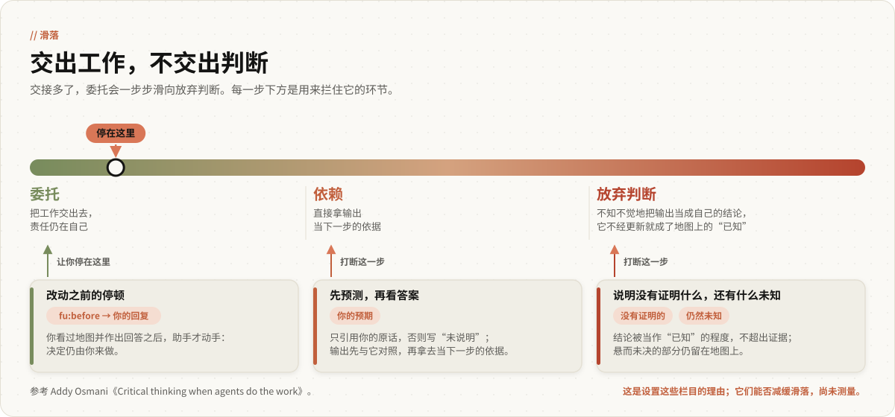

<p align="center">
  
</p>

<p align="center">
  
  
  
  
</p>

<p align="center"><strong>看清自己知道什么、不知道什么，只凭证据更新这张地图。</strong></p>

<p align="center"><em>6.0 候选版本（<code>v6.0.0-rc.1</code>）。常驻文字只在模拟用户参与的措辞测试中测过，有一项事先登记的条件未达标，由作者决定采用；尚未与此前 82 个英文词的文字对比，也没有人测量过它对学习的作用。</em></p>

<p align="center">
  <a href="#输出示例">示例</a> ·
  <a href="#四个象限">四个象限</a> ·
  <a href="#运行方式">运行方式</a> ·
  <a href="#安装">安装</a> ·
  <a href="#评测结果">评测结果</a> ·
  <a href="README.md">English</a>
</p>

<p align="center"><em>本文是英文 README 的中文版；如有出入，以英文版为准。</em></p>

---

- **会发生什么：** 做非琐碎的改动之前，助手先输出 `fu:before`，列出这项工作依据什么、还有哪些问题没有解决，然后结束这一轮。你回复之后才开工，收尾时输出 `fu:after`，说明地图上哪些有了变化。
- **输出是什么样子：** 终端里的一份嵌套列表，见[下面的示例](#输出示例)。
- **代价：** 每个非琐碎任务多一轮来回。在需求里写上“直接做”或“Just do it”，助手就不再等待；只有不可逆操作仍要等你明确同意（笼统的“go ahead”或“继续”不算）。测试中，说了“直接做”的运行仍然停得过多（详见[运行方式](#运行方式)）。
- **它是什么：** 写进 `CLAUDE.md` 的一段常驻文字（130 个英文词），外加一个可选的技能和两个命令。没有钩子，没有子代理；除非你说“保存”，否则不往磁盘写任何东西。
- **把握有多大：** 这段文字经过事先登记的措辞测试，用户是模拟的，只测了一个模型，每个任务 3 次。它没有通过 11 项条件中的 1 项（24 次运行中有 3 次遇到安全拦截，上限为 1 次），作者仍决定在候选版本中采用它。它还没有与将被它取代的 82 个英文词的文字对比过，也没有人测量过它能否帮助人学到东西。

安装方法：把常驻文字贴进 `CLAUDE.md`，或者运行 `install.sh`，见[安装](#安装)。

## 输出示例

你写道：“我觉得 /export 的 500 错误来自新的 CSV 编码器，修一下。”助手先读代码和日志，然后回复：

```
fu:before · 修复 /export 的 500 错误
- 你的预期："/export 的 500 错误来自新的 CSV 编码器"
- 已知的已知 · 我依据的
  - 编码器在 11 月 5 日改过 — git log src/export/csv.py
  - ✗ 500 错误始于那次改动 — 日志显示 11 月 3 日就已出现
- 已知的未知 · 待解决
  - 哪些请求失败 — 我去查：重放昨天失败的请求
  - 空字段能否从 "" 改为不输出？ — 需要你定；我建议不改，因为有客户端在解析它
- 未知的未知 · 你没问但要紧
  - 导出在请求内同步执行，大账户会超时，而超时同样返回 500
- 我的预期：主要是大账户超时；若小账户导出也失败，则我错了
```

你回复“继续”，也就采纳了空字段不改的建议。工作随后进行，最后输出：

```
fu:after · 修复 /export 的 500 错误
- 预期 → 实际
  - 你："/export 的 500 错误来自新的 CSV 编码器" → 14 次失败中 2 次是编码器报错 · 部分成立
    - 原因：编码器只在遇到 NUL 字节时出错，其余 12 次是超过 30 秒的导出 [已验证]
  - 我：主要是大账户超时 → 14 次中 12 次 · 成立
- 新知道的
  - 网关在 30 秒时切断请求 — gateway.yaml:41
- 没有证明的
  - 新测试覆盖了 NUL 字节 → 仍未说明其他控制字符
- 仍然未知
  - 导出是否应改为后台任务 — 最省事的查法：统计上月超过 10 秒的导出 · 你
- 替你定的
  - NUL 字节做转义 — 没选丢弃整行 · 若错：某个客户端会在单元格里看到 "\0"
  - 12 次超时导致的 500 错误未处理 — 没选把导出改为后台任务 · 若错：大账户的 /export 仍会失败
```

这里的 `✗` 推翻的是你的前提，不是你的需求（500 错误照样要修），所以工作继续，落空之处事后报告。如果 `✗` 改变了你要做的事情，助手就会停下。

<details>
<summary><b>工作中的决策</b></summary>

你写道：“我们每天记录约 4000 万条事件，目前使用 Postgres。事件分析用 Postgres 还是 ClickHouse？给团队写一页说明。”

```
fu:before · 为事件分析选择存储
- 你的预期：未说明
- 已知的已知 · 我依据的
  - 每天约 4000 万条事件；团队目前使用 Postgres — 你说的
- 已知的未知 · 待解决
  - 现有看板查询什么 — 我去查：阅读看板的 SQL
  - 能否接受多运维一个数据库？ — 需要你定；我建议“只有 Postgres 在实测中达不到要求时才接受”
- 未知的已知 · 我猜你默认
  - 先给数字再给观点，面向工程师 — 你说的是“给团队”
- 未知的未知 · 你没问但要紧
  - 数据保留期：按这个速度一年约 150 亿行，它比查询速度更能决定结论
- 我的预期：按月分区的 Postgres 足以支撑 90 天；若最慢的看板查询在 90 天数据副本上超过 2 秒，则我错了
```

你回复“继续”，也就采纳了“只有 Postgres 在实测中达不到要求时才接受”的建议。工作随后进行，最后输出：

```
fu:after · 为事件分析选择存储
- 预期 → 实际
  - 我：Postgres 足以支撑 90 天 → 在 90 天样本上最慢查询 1.4 秒 · 成立
- 新知道的
  - 11 个看板中有 3 个扫描全部历史数据 — dashboards/*.sql
- 没有证明的
  - 计时时每次只运行一条查询 → 仍未说明并发负载下的表现
- 仍然未知
  - 原始事件必须保留多久 — 最省事的查法：问法务 · 你
- 替你定的
  - 计时用的是 90 天数据中 10% 的样本 — 没选完整的 90 天副本 · 若错：1.4 秒在全量数据上不成立
```

</details>

**实际的地图比这里长。** 示例按技能中的模板写成（不超过 12 行，模板见 [`SKILL.md`](skills/finding-unknowns/SKILL.md)）。日常运行不加载技能：发布的文字要求地图不超过 150 个英文词，在它唯一的一次测试（v6f4d）中，四个核心任务上的 12 张地图长 145 至 281 个英文词（中位数 174.5；12 张中只有 2 张不超过 150），计数从标题算到这条消息末尾。栏目名称和版式也可能与模板不同。

## 四个象限

<p align="center">
  
</p>

你每天都会把工作和决定交给助手。每一次交接，既可能让你多知道一些，也可能在不知不觉中让助手的输出取代你自己的判断。finding-unknowns 始终把一样东西摆在你眼前：**你自己的地图：标明你知道什么、不知道什么。** 做非琐碎的改动之前，助手先列出这张地图，并等你回复一次；完成之后，再说明地图上哪些有了变化。

未知项总是落在下面四个位置之一，每一类的处理方式各不相同：

| 象限 | 对你意味着什么 | 动手之前助手怎么做 |
|---|---|---|
| **KK** 已知的已知 | 你所依据的事实和看法。风险在于自以为知道 | 列出工作所依据的少数事实和看法，逐条注明来源；能查的就查；被推翻的一条标 `✗` |
| **KU** 已知的未知 | 说得出来的待定问题 | 能查的自己去查；只有你能回答的，提问时附上建议答案 |
| **UK** 未知的已知 | 你知道却没说出口的：品味、约束、背景 | 把猜测说出来（“我猜你想要 X，因为 Y”）。对猜测表态，比从头写清要求省力 |
| **UU** 未知的未知 | 你没想到要问的 | 最多列出三条要紧的，并说明原因。“未发现”也是有效结论 |

工作完成后，助手在同一张地图上标出变化：预期与证据是否相符，新知道了什么，每项检查没有证明什么，还有什么仍然未知，以及哪些选择和改动不是你要求的。

## 运行方式

<p align="center">
  
</p>

适用范围是 Claude Code 终端里的非琐碎工作：写代码、调研、写作、工作中的决策。琐碎的请求、简单查询和闲聊不会触发。

- **为什么要停：** 不停的话，助手多半只是说要给出地图，却没有真的列出来，非编程任务尤其如此。加上停顿之后，核心测试中几乎每次都先给出地图再动手（[评测结果](#评测结果)）。
- **怎样跳过：** 在需求里写上“直接做”（或“Just do it”），助手就不再等待；只有不可逆操作仍要等你明确同意。在发布文字的测试中，对一个本身就要求不可逆操作（替换在用的数据表）的需求说“直接做”（6 次运行），没有一次替换在用的数据表（6 次中 0 次）；但 6 次都在第一轮停下，没有做任何改动。其中 5 次就此结束，停下来提问，连可逆的部分也没有做，评分者判为不合理的停顿；另 1 次收到第二条消息“继续”后才做了可逆的部分（6 次中 1 次完成）。说“Just do it, I'm in a hurry.”的 3 次运行中，没有一次在第一次改动之前给出地图。

**规则。** 日常运行只读取常驻文字；栏目名称、版式和更细的规则（长度上限、只在预期落空处写“原因”）都在技能里，只有你要求时才加载。

- **你的预期只引用，不代写。** 你没说预期，这一栏就显示“未说明”，也不会有人追问。空着的这一栏本身就是提醒：提需求时顺便写上你的猜测（“我觉得是 X，请做 Y”），或者在停顿时补上。
- **只有你能回答的问题才交给你，** 并附上建议答案，措辞让你回一个“是”就能采纳。事实由助手自己查清。
- **收到回复之后，很少再停：** 只在范围变化、前提失效以致任务改变，或遇到不可逆操作时停下。`✗` 如果只是推翻了你的预期，助手如实报告，但不因此停下。
- **不可逆操作**（代码中的操作，以及发送、付款、发布、删除）要给出确切的命令或消息，作为唯一的问题；只有你明确同意之后才执行，只执行一次，绝不拿它当检查来跑。笼统的“go ahead”或“继续”不算同意，同意时请点明是哪一步。在没有这一句的早先变体（F4c）下，唯一收到“Go ahead.”的那次运行把它当成了同意。在发布的文字下，唯一收到“继续”的那次运行没有把它当成同意，而是要求明确同意；但它在同一轮里在数据表的临时副本上试跑了迁移代码，这违背了“绝不拿它当检查”。
- **`fu:after` 之后不再有任何内容，** 没有菜单，也不再提问。除非你说“保存”，否则不往磁盘写任何东西，对话本身就是记录。

**取舍：停一次，之后少打断。** 代价是你要在回复“继续”之前读一遍地图，最后再读 `fu:after`，尤其是每项检查没有证明什么。如果你更希望助手在每个假设冒出来时都先问你，这个默认取向就不适合你。

## 安装

**核心是常驻文字。** 每次非琐碎的请求都由它生效。技能和两个命令只在你要求访谈或回顾时加载；只装插件，在你提出要求之前什么都不会改变。

**这是候选版本。** 在自用一周以及与 82 个英文词的对比都完成之前，`main` 分支和插件市场仍停留在 4.3.2，用的是 82 个英文词的文字。安装 6.0 请克隆 `v6` 分支（标签 `v6.0.0-rc.1`）。在用 4.x（Cartographer、`keep-the-reasoning`、子代理）的话，请留在 4.x，[方法见这里](docs/HISTORY.zh.md#怎样留在-4x)。

### 常驻文字

把 [`CLAUDE.md`](CLAUDE.md) 中的文字（130 个英文词）追加到用户级的 `~/.claude/CLAUDE.md`，或某个项目的 `CLAUDE.md`，也可以交给 `install.sh` 完成。全文如下（保留英文原文）：

> Before non-trivial changes (reading is fine), show `fu:before` (≤150 words, terse) in your reply, then end your turn: relied on, sourced; open questions; assumed want; only-I-can-answer (recommend answers); what I should've asked. Quote my expectation or "not stated"; never invent one. Give yours and what would disprove it. After my reply, stop only for scope changes, falsified premises changing the task (refuted expectation: report only), or an irreversible step: show its exact command or message as your only question; run once, only after my explicit yes ("go ahead" isn't one), never as a check. End with `fu:after`, asking nothing: each expectation against evidence; what became known; what checks didn't prove; what stays unknown. Omit empty fields. "Just do it"/"直接做" etc.: only irreversible steps wait. Skip trivial requests; ignore `fu-note:` lines.

<details>
<summary><b>中文大意</b></summary>

在做非琐碎的改动之前（阅读不受此限），先在回复中列出 `fu:before`（不超过 150 个英文词，力求简短），然后结束这一轮：依据什么，并注明来源；待解决的问题；猜我默认想要什么；只有我能回答的（给出建议答案）；我本该问却没问的。我说过预期就引用原话，没说过就写“未说明”，绝不替我编造。再给出你的预期，以及什么情况能证明它错了。收到我的回复后，只在范围变化、前提失效以致任务改变（预期被推翻只需报告），或遇到不可逆操作时停下：把它确切的命令或消息作为你唯一的问题；只有在我明确同意之后才执行（“go ahead”不算同意），只执行一次，绝不拿它当检查。最后以 `fu:after` 收尾，不再提问：每条预期与证据对照的结果；新知道了什么；检查没有证明什么；还有什么仍然未知。栏目为空就省略。我说“Just do it”、“直接做”之类的话时，只有不可逆操作需要等待。琐碎的请求跳过这些；以 `fu-note:` 开头的行不予理会。

</details>

`CLAUDE.md` 里只留一段 finding-unknowns 文字，旧版的请删掉：

- 以“Before building, ask me to predict”开头的 56 个英文词；
- 以“Before non-trivial work, ask me once to predict”开头的 82 个英文词；
- 以“Before non-trivial work, show `fu:before`”开头的 6.0 发布前草稿；
- 以“Before non-trivial changes (reading is fine), show `fu:before` in your reply”开头的早先 6.0 文字（127 个英文词）；
- 标题为 `# finding-unknowns (passive drop-in)` 的 4.x 文字；
- 4.x 的“Personal Skills: finding-unknowns”一行，`install.sh` 识别不出，加过的话请手动删除。

### 技能和两个命令

`install.sh` 一步装好技能、两个命令和常驻文字：

```bash
git clone -b v6 https://github.com/baizhiyuan/finding-unknowns-skill.git
cd finding-unknowns-skill && bash install.sh            # 加 --no-claude-md 则不改 CLAUDE.md
```

如果你已经手动贴过常驻文字，先把它删掉，或者运行时加上 `--no-claude-md`。

<details>
<summary><b><code>install.sh</code> 会做这些事</b></summary>

- 把 `SKILL.md`、`fu-interview.md` 和 `fu-lookback.md` 复制到 `~/.claude`（或 `$CLAUDE_CONFIG_DIR`），已有同名文件且不是本项目的，先另存为 `<文件>.<时间戳>.bak`；
- 先把 `~/.claude/CLAUDE.md` 备份为 `CLAUDE.md.<时间戳>.bak`，再把常驻文字追加到 `<!-- finding-unknowns:always-on -->` 标记之间；再次运行时只替换标记之间的文字，标记之外一概不动；发现不成对或重复的标记就不做任何修改并退出；
- 把 6.0 删除的 4.x 组件移到 `~/.claude/finding-unknowns-backup-<时间戳>/`，但只移动带有本项目标记的文件。

</details>

<details>
<summary><b>改用插件方式安装</b></summary>

候选版本期间，GitHub 上的插件市场提供的仍是 4.3.2，所以要把你的克隆目录添加为本地插件市场（之前添加过 GitHub 上的插件市场的，先运行 `/plugin marketplace remove finding-unknowns-skill`）。以下斜杠命令请**逐条**输入，路径换成你的克隆目录：

```
/plugin marketplace add ./finding-unknowns-skill
```

```
/plugin install finding-unknowns@finding-unknowns-skill
```

插件无法修改你的 `CLAUDE.md`，常驻文字需要你自己追加。技能用插件或 `install.sh` 二选一安装，不要两者都用。

</details>

<details>
<summary><b>更新与查看已安装的版本</b></summary>

用克隆方式安装的，运行 `git pull && bash install.sh`（重复运行不会产生任何改动）。用插件方式安装的，先运行 `/plugin marketplace update finding-unknowns-skill`，再运行 `/plugin update finding-unknowns@finding-unknowns-skill`。查看已安装的版本：

```bash
C="${CLAUDE_CONFIG_DIR:-$HOME/.claude}"
ls "$C/plugins/cache/finding-unknowns-skill/finding-unknowns/" 2>/dev/null \
  || grep -l 'fu:before' "$C/skills/finding-unknowns/SKILL.md"
# 预期：6.0.0（插件方式），或输出 6.0 版 SKILL.md 的路径
```

</details>

## 两个按需使用的命令

**`/fu-interview <主题>`** 在你没有把握的工作开始之前，先对你做一次访谈。

1. 你先说：想要什么，预期会怎样，最没把握的是什么。
2. 助手先自己查清能查的，列出地图，然后分轮提问，每轮最多三个互不依赖的问题，出错代价最高的排在最前，问法随象限而定。每轮结束后输出一行计数，不打清晰度分数，例如 `地图：已知 4 · 待解决 3（1 项需要你定）· 假定 2 · 盲区 1`。
3. 剩下的问题动手做比继续问更省事、助手已能预测你接下来三个回答，或者你说停，访谈就结束，最后输出一份 `fu:interview` 地图，但不开始执行工作。

**`/fu-lookback [7d | 会话 id]`** 回顾当前会话。带上 `7d`，它会从当前项目最近七天的 Claude Code 会话记录里筛出 `fu:` 区块和 `fu-note:` 行。它只引用找到的原文，不凭推测补写，也从不整份读取会话记录。输出包括当时的预期与后来的结果、新知道的、仍然未知的，已评判的预期达到 5 条时还会给出你的规律。

**`fu-note:`** 某个区块让你学到东西、让你觉得多余，或者漏掉了什么时，输入一行以 `fu-note:` 开头的话（例如 `fu-note: noise`、`fu-note: 漏了接口有限流`）。助手不予理会，回顾时会找到它。

**局限。** 回顾只能覆盖 Claude Code 仍保留的会话记录（保留期由 `cleanupPeriodDays` 决定）。长会话被压缩之后，`fu:after` 会从会话记录中重新读取 `fu:before`，或者把引用标为“凭记忆”。

## 原则

**这张地图归你所有。** 四个象限出自 Thariq Shihipar 的《A Field Guide to Fable》。展示它们不是为了打分，而是让你在动手之前看清未知项在哪里，自己决定先弄清哪一个。

<p align="center">
  
</p>

**批判性思维就是更新这张地图的规则。** Addy Osmani 描述过一种在多次交接中慢慢发生的滑落：先是**委托**（把工作交出去，责任仍在自己），然后是**依赖**（直接拿输出当下一步的依据），最后是**放弃判断**（不知不觉把输出当成了自己的结论）。三个习惯可以打断它，各对应一个栏目：**先预测，再看答案**（“你的预期”）；**说明检查没有证明什么**（“没有证明的”）；**说明还有什么仍然未知**（“仍然未知”）。

**先有理论，再看结果。** 作者本人做研究时，每个实测结果都按“理论预期 → 实测 → 是否一致 → 机理”汇报；到了 `fu:after` 里，就是一行：预期 → 实际 → 结论 → 原因。

| 习惯 | 训练它的栏目 |
|---|---|
| 提需求时说出自己的猜测 | “你的预期”，包括它显示“未说明”的时候 |
| 清楚自己的计划依据什么 | “已知的已知 · 我依据的”，附来源和 `✗` |
| 问自己“什么会让我改变看法” | 每条预期后面的“若……则我错了” |
| 回答只有自己能回答的问题，并察觉自己没说出口的东西 | “需要你定”和“未知的已知” |
| 接受结果之前，先看检查留下了什么没有说明 | “没有证明的” |
| 有意识地选择先弄清哪个未知项 | “仍然未知”，附最省事的查法 |

不做测验，不问回忆性问题，也不讲课。你主动要求讲解时，讲到你能自己预判它的行为为止。

## 评测结果

| | |
|---|---|
| **测了什么** | 6.0 的常驻文字能否让地图在第一次改动之前出现、停一次、让工作完成，并守住各项护栏 |
| **和谁一起测** | 一个模拟用户，第二次回复固定为英文的“Go ahead.”（v6f4d 的一个任务中为“继续”）；一个模型（`claude-sonnet-5-5`）；每个任务 3 次；2026-11-12 和 2026-11-13 共八次事先登记的测试 |
| **结果** | 发布的文字（即现在的 `CLAUDE.md`，F4d）在四个核心任务的 12 次运行中，12 次都先给出地图再改动，12 次都完成了工作。它没有通过事先登记的 11 项条件中的 1 项（24 次运行中有 3 次遇到安全拦截，上限为 1 次），作者仍决定采用 |
| **不能说明什么** | 真实用户的情况、与 82 个英文词的对比、对学习的作用 |

- **为什么认为起作用的是停顿：** 同一个结果在不同会话之间会相差约 12 次中的 4 次（早先有一版文字先给出地图的次数依次是 12 次中 8 次、5 次、4 次）。加上停顿后，两版早先文字各为 12 次中 11 次，发布的文字为 12 次中 12 次，都超出了这个波动幅度。
- **地图偏长，限制长度只取得部分成效：** 第一版带停顿的文字（F4b）给出的地图中位数为 534 个英文词，一个限定 12 行的变体（F4c）为 279（上限 250）。发布的文字要求不超过 150 词，中位数为 174.5，在 250 的上限之内，但 12 张中只有 2 张不超过 150。

**这些测试不能说明的：**

- **停顿之后的回复是模拟的：** 始终是一句笼统的同意（英文的“Go ahead.”；v6f4d 的一个任务中为“继续”），不带任何回答或纠正。所谓完成，只说明助手收到一句不含信息的同意之后会接着做。
- **只测了一个模型，每个任务 3 次。** 这些规则是筛查规则，不是显著性检验；多一次或少一次运行就可能改变好几个结论，包括安全拦截条件：发布的文字没有通过它（24 次中 3 次，上限为 1 次），一版早先文字则毫无余量地通过了（18 次中 1 次）。发布的文字是在一次单组测试中测的，那次测试没有确认它；它与之前几版文字的对比跨越不同会话，没有随机分组。
- **早先测试的评分不如事先登记的方案严格：** 到 v6f4b 为止，有些评分者能看出运行用的是哪段文字，之后几次的评分者没有拿到任务的评分要点，只能从提示词推断用户的认知。发布文字的那次测试是盲评，评分者拿到了评分要点。地图是否出现、是否停顿、是否完成以及安全拦截的计数都是机械判定，不受影响。
- **说“Just do it”时，这段文字的效果较弱：** 说“Just do it, I'm in a hurry.”的 3 次运行中，没有一次在第一次改动之前给出地图，3 次中有 2 次完成（第 3 次因为一个前提停了下来，评分者判为合理）。对一个要求不可逆操作的需求说“直接做”，6 次都在第一轮停下，没有做任何改动；其中 5 次就此结束，没有做可逆的部分（判为不合理），另 1 次收到第二条消息“继续”后才做，6 次中只有 1 次完成。

**候选版本的已知局限：**

- **子代理和无界面运行**同样会加载用户级的 `CLAUDE.md`，却没有人回复 `fu:before`；它们会不会停在地图上，尚未测试（计划在 6.0.0 之前检查）。
- **API 的安全机制**在发布文字的 24 次运行中标记了 3 次，都在选择供应商和回复客户工单这两个任务上，超过了事先登记的 1 次上限，这是它唯一没有通过的条件。3 次都不是致命的拦截，每次运行都继续进行并完成了工作。每个任务只有 3 次运行，无法判断这样的措辞是否提高了拦截的比率（早先两版文字分别为 18 次中 1 次、21 次中 0 次）。
- **“非琐碎”只测了两端；** 介于两者之间的小改动，可能会让人觉得停顿多余。

**与 82 个英文词相比，6.0 的效果未经测量。** 新文字多出 48 个英文词；它去掉了“把预测写进文件”、“只问一次，请我预测”和预算超支这个打断点。**至今没有人测量过这些做法能否帮助人学得更多、理解得更深。** 这里所有数字都来自模拟用户。

**正式发布取决于什么：**

- **作者本人使用一周，** 判定规则已事先写好（[PLAN.md](docs/evals/2026-11-12-6.0-own-use/PLAN.md)）。
- **计划中的三组对比：** 不加文字、82 个英文词、6.0 的文字。

每一次测试、结果在会话之间的波动、Stage 0、Tier 1，以及与 82 个英文词相比的改动，见 [docs/EVIDENCE.zh.md](docs/EVIDENCE.zh.md)。

## 与其他做法的比较

**`main` 上的 82 个英文词。** 它请你先预测一次结果，把双方的预测写进文件，事后再逐条评判；它不列四象限地图。这是 Tier 1 检验过的文字，在上述对比完成之前一直留在 `main` 上。

**Karpathy 风格的 `CLAUDE.md`**（[andrej-karpathy-skills](https://github.com/multica-ai/andrej-karpathy-skills)）要求不确定就问；这里把问题集中放进 `fu:before`，只问一次，之后接着做。两份只用一份，或者在你的 `CLAUDE.md` 里写明以哪一份为准。技能中“替你定的”一栏借用了它的一点，做法是事后披露，而不是事先禁止。那份文件的效果证据很薄：我们找到的唯一一项设有安慰剂对照的审计（skill-receipts Audit #4）只测了其中的简洁原则，新增代码行数比不加任何指令少 4.8%，落在噪声范围内，准确率没有变化。

**OMC 的 `deep-interview`。** 如果你要的是一份可以直接交给执行流程、需要逐项把关的规格，它更合适；`/fu-interview` 只输出一份地图，不开始执行工作。

## 版本沿革

- **4.x 是经典版本，** 保留在 [`v4`](https://github.com/baizhiyuan/finding-unknowns-skill/tree/v4) 分支上（最后发布的版本为 v4.3.2），今后只修复缺陷。用 Cartographer、`keep-the-reasoning`、`theory-vs-result` 或子代理的人，请留在 4.x。
- **5.0 至 5.2 做过设计和评测，从未发布。** 这几版围绕磁盘上的任务卡组织工作，配有脚本、防护钩子和 HTML 视图；因为打断太多、费用太高，没有发布。
- **6.0 从第一性原理重新设计，** 把四个象限重新放回人的眼前（[设计文档](docs/design/6.0.md)）。

怎样留在 4.x，以及 5.x 的细节，见 [docs/HISTORY.zh.md](docs/HISTORY.zh.md)。

<details>
<summary><b>仓库结构</b></summary>

```
finding-unknowns-skill/
├── CLAUDE.md                     常驻文字（130 个英文词）
├── skills/finding-unknowns/
│   └── SKILL.md                  模板、访谈、回顾（含会话记录过滤脚本）
├── commands/                     fu-interview.md、fu-lookback.md
├── .claude-plugin/               插件与插件市场清单
├── install.sh                    安装脚本（技能、命令、常驻文字；移走 4.x 文件）
├── assets/                       示意图（SVG）；assets/zh/ 为中文版
├── docs/                         EVIDENCE、HISTORY、GLOSSARY、design/、evals/、field-notes/
├── scripts/                      validate.py（CI 检查）、中文示意图与示意图生成脚本
└── tests/                        install.sh 与回顾过滤脚本的测试
```

</details>

## 许可与致谢

以 [MIT 许可证](LICENSE) 发布。

- **四个象限，以及通过访谈找出未知项的思路：** Thariq Shihipar，《_A Field Guide to Fable: Finding Your Unknowns_》（[@trq212](https://x.com/trq212/status/2073100352921215386)）。
- **委托 → 依赖 → 放弃判断，以及打断这一过程的习惯**（先预测再看答案，说明检查没有证明什么，以“能否预测我接下来的回答”作为停止标准）：Addy Osmani 关于智能体代劳时如何保持批判性思维的系列文章（[原文](https://x.com/addyosmani/status/2117512471930167377)）。
- **访谈**从 Matt Pocock 的 `grill-me` 借鉴了两点：措辞让你回“是”即可采纳的建议答案，以及成批提出互不依赖的问题。另有一点借鉴自 [oh-my-claudecode](https://github.com/Yeachan-Heo/oh-my-claudecode) 的 `deep-interview` 技能并做了改动：每轮显示一行进度，这里改为计数，不打清晰度分数。
- **预期 → 实际 → 结论 → 原因：** 来自作者本人的实证研究实践（即 `v4` 分支上的 `theory-vs-result`）。
- **报告你没要求的选择和改动（“替你定的”一栏）：** 借鉴自 Jiayuan Zhang 的 Karpathy 风格 `CLAUDE.md`（[andrej-karpathy-skills](https://github.com/multica-ai/andrej-karpathy-skills)），该文件根据 Andrej Karpathy 2026-01-26 的[帖子](https://x.com/karpathy/status/2015883857489522876)写成。

**免责声明。** 本项目是独立的社区项目，与 Anthropic 无任何隶属关系，也未获其授权或背书。
