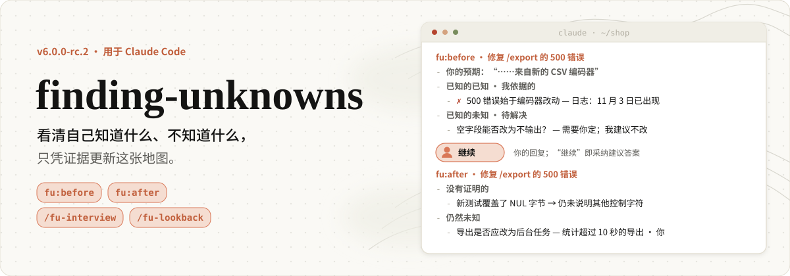
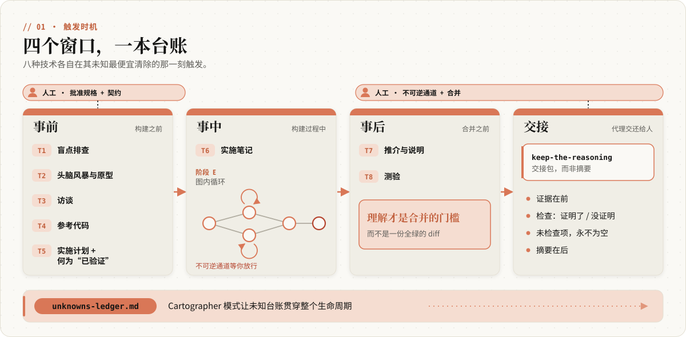
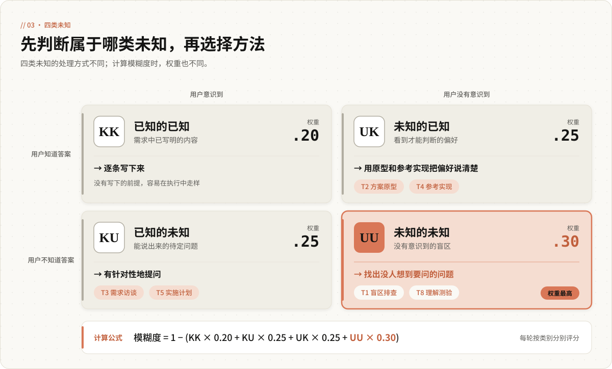
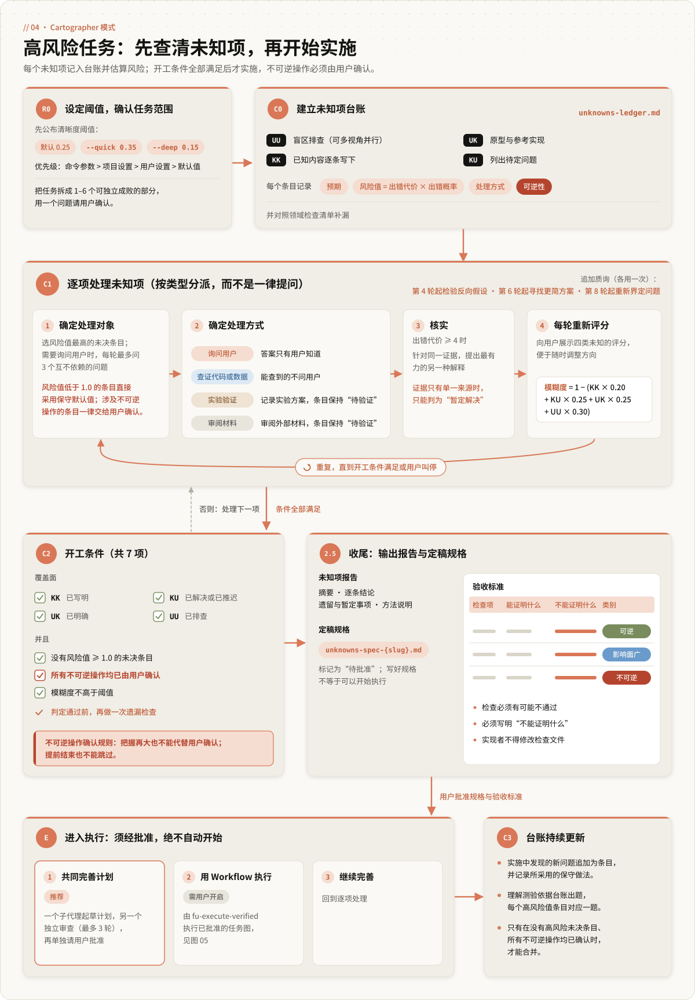
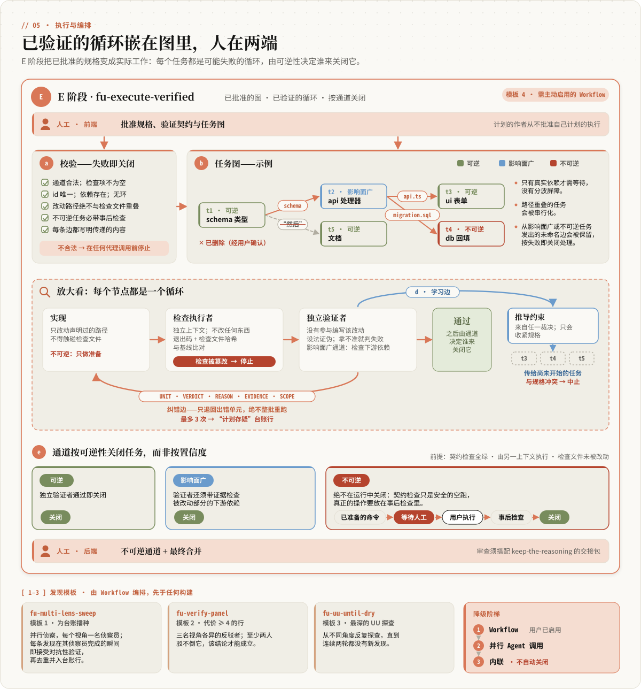
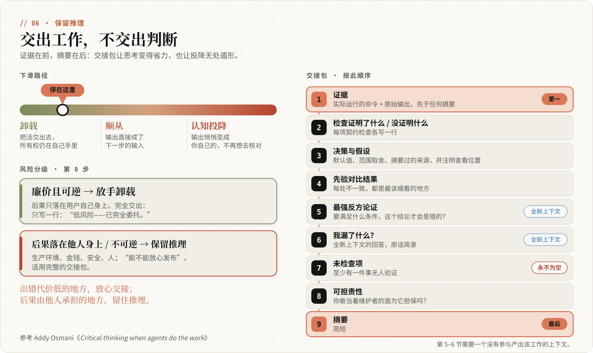
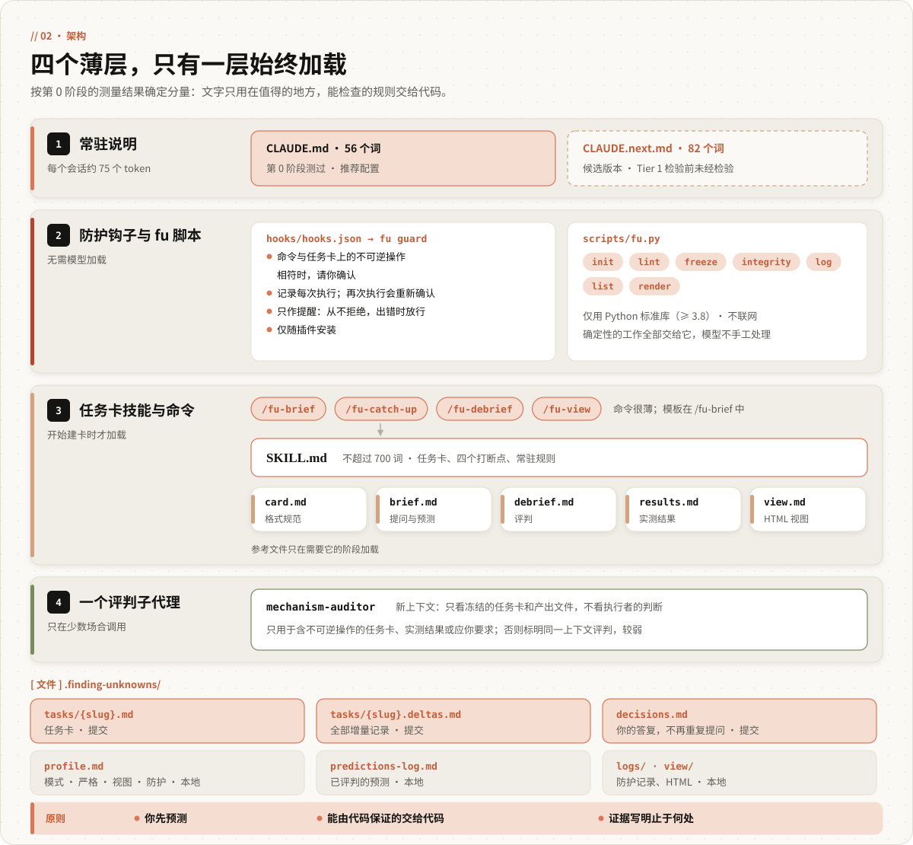

<p align="center">
  
</p>

<p align="center">
  
  
  
  
  
</p>

<p align="center"><strong>在未知项造成高昂代价之前把它们找出来；智能体交付成果时，判断仍由你来做。</strong></p>

<p align="center"><em>地图不是疆域。长周期工作能做到多好，取决于你把自己的未知项弄清到什么程度。</em></p>

<p align="center">
  <a href="#快速开始">快速上手</a> ·
  <a href="#功能特性">工作原理</a> ·
  <a href="#命令">命令</a> ·
  <a href="#文档">文档</a> ·
  <a href="README.md">English</a>
</p>

<p align="center"><em>本文是英文 README 的中文版；如有出入，以英文版为准。</em></p>

---

## 快速开始

**第 1 步：安装**

推荐通过插件市场安装。以下是 Claude Code 的斜杠命令，请**逐条**输入：

```
/plugin marketplace add baizhiyuan/finding-unknowns-skill
```

然后：

```
/plugin install finding-unknowns@finding-unknowns-skill
```

如果想克隆仓库安装，`install.sh` 会安装三个技能、`references/`、五个子代理和全部斜杠命令。

```bash
git clone https://github.com/baizhiyuan/finding-unknowns-skill.git
cd finding-unknowns-skill && bash install.sh
```

如果不想安装任何东西，可以把 [`CLAUDE.md`](CLAUDE.md) 复制到项目根目录，获得一份轻量、始终生效的引导。

<details>
<summary><b>手动复制（仅技能）</b></summary>

```bash
mkdir -p ~/.claude/skills/finding-unknowns/references ~/.claude/skills/keep-the-reasoning ~/.claude/skills/theory-vs-result
cp skills/finding-unknowns/SKILL.md ~/.claude/skills/finding-unknowns/
cp skills/finding-unknowns/references/*.md ~/.claude/skills/finding-unknowns/references/
cp skills/keep-the-reasoning/SKILL.md ~/.claude/skills/keep-the-reasoning/
cp skills/theory-vs-result/SKILL.md ~/.claude/skills/theory-vs-result/
```

</details>

**第 2 步：首次使用**

```
/finding-unknowns "add a usage dashboard to the admin app"   # 判断未知类别，说明选用哪种方法，然后执行
/blindspot "src/auth"                                        # 只读侦察：雷区、隐藏背景、专家会问的问题
/change-quiz main..HEAD                                      # 变更报告 + 合并前必须通过的理解测验
```

**第一次使用本插件？** [5 分钟教程](docs/TUTORIAL.zh.md)提供三个可直接复制的练习：在一个真实的开源仓库上做盲区排查、写一份交付报告、写一张理论与实测卡片。三个技能共用的术语（预期、可逆性类别（lane）、严谨级别、交付报告大小、模式、独立上下文反驳）统一定义在[术语表](docs/GLOSSARY.md)中（英文）。

### 不知道从哪里开始？

如果任务还很模糊，或者你不熟悉相关领域或代码库，先运行下面的命令。

```
/finding-unknowns "我想要……"
```

第 0 阶段会判断缺口属于哪个象限，记下你的预期，再交给能解决它、且代价最低的方法。如果确实没有重要的未知项，它也会明确告诉你。

- **高风险**（难以撤销、影响面广，或领域陌生且周期长）→ `/cartographer --deep "…"`
- **工作已经完成，风险在于验收** → `/keep-the-reasoning "…"`
- **结果已经出来（或即将测量），风险在于误读结果** → `/theory-vs-result "…"`（每次都能复现的失败测试或崩溃走更轻量的调试路径）

### 更新

按当初的安装方式更新即可。最新版本为 **v4.3.2**。

```
/plugin marketplace update finding-unknowns-skill
```

```
/plugin update finding-unknowns@finding-unknowns-skill
```

<details>
<summary><b>克隆安装、手动复制与版本核对</b></summary>

**克隆方式。** `install.sh` 会直接覆盖已安装的文件，因此也可以用来更新。

```bash
cd finding-unknowns-skill && git pull origin main && bash install.sh
```

**手动复制。** 用新文件覆盖原来的同名文件。`references/` 中包含 Cartographer 协议和 Workflow 模板，也必须一并更新；v4 新增了 `keep-the-reasoning` 技能，v4.1 又新增了 `theory-vs-result`。

```bash
cd finding-unknowns-skill && git pull origin main
mkdir -p ~/.claude/skills/finding-unknowns/references ~/.claude/skills/keep-the-reasoning ~/.claude/skills/theory-vs-result
cp skills/finding-unknowns/SKILL.md ~/.claude/skills/finding-unknowns/
cp skills/finding-unknowns/references/*.md ~/.claude/skills/finding-unknowns/references/
cp skills/keep-the-reasoning/SKILL.md ~/.claude/skills/keep-the-reasoning/
cp skills/theory-vs-result/SKILL.md ~/.claude/skills/theory-vs-result/
cp agents/*.md   ~/.claude/agents/
cp commands/*.md ~/.claude/commands/
rm -f ~/.claude/commands/finding-unknowns.md ~/.claude/commands/keep-the-reasoning.md ~/.claude/commands/theory-vs-result.md  # 4.3.0 起删除；这三个斜杠命令由同名技能响应
```

**核对版本：**

```bash
grep '"version"' ~/.claude/plugins/*/finding-unknowns*/.claude-plugin/plugin.json 2>/dev/null \
  || ls ~/.claude/skills/finding-unknowns/references/cartographer.md ~/.claude/skills/keep-the-reasoning/SKILL.md ~/.claude/skills/theory-vs-result/SKILL.md
# 预期：4.3.2（插件方式），或列出这三个文件（theory-vs-result 从 v4.1.0 起才有）
```

</details>

---

## 为什么选择 finding-unknowns？

- **模型会在信息缺口处猜测。** 上文所说的地图，指你交给 Claude 的内容（提示词、上下文、技能）；疆域指代码库和现实世界。两者之间的每一处差距，都会迫使模型猜测你的意图。在长周期工作中，限制结果的已经不是模型能力，而是任务本身是否清晰。
- **按象限选择方法，而不是凭习惯。** 盲区需要侦察，看到才能判断的偏好需要原型，能说出来的待定问题需要有针对性的提问，对改动的理解需要测验来检验。用同一套访谈应对这四种情况，哪一种都处理不好。
- **Cartographer 模式按覆盖面把关。** 它面向高风险任务，包括按风险值排序的未知项台账、每轮展示的清晰度评分（仅供参考），以及 6 项可对照台账核查的开工条件。相关代码和实际情况没有查清之前，不会开始任何实现。默认在写出规格和验收标准后结束。
- **不可逆操作确认规则。** 是否放行取决于影响范围，而不是把握大小。只要某个未知项关系到不可逆的步骤，无论证据看起来多么确凿，都会交给你确认。
- **交付时由人保留判断。** 交付报告先列证据，写明每项检查*不能*证明什么、哪些内容没有人检查过，以免在验收智能体成果时不知不觉地放弃判断。
- **先有理论，再看数据。** 每个实测结果都按“理论预期 → 实测 → 是否一致 → 机理”呈现：预测先写下，噪声下限讲清楚，机理标明证据强弱，按预先约定的规则得出的判定与对方向本身的判断分开写。
- **独立判断。** 方案的作者不批准自己的方案。排查、评分和测验都在未参与实现的上下文中进行；三个技能共用同一项检查，即**独立上下文反驳**：由没有产出该结论的上下文给出最有力的替代解释，以及能区分两者的代价最低的检查。
- **零依赖。** 全部内容都是纯 Markdown。子代理和 Workflow 脚本可以让排查更深入；没有它们，每种方法也能在当前会话内完整运行。

> **来源说明。** 这些方法及其名称出自 Thariq Shihipar 的文章《_A Field Guide to Fable: Finding Your Unknowns_》（[@trq212](https://x.com/trq212/status/2073100352921215386)）；底层理念归功于原作者，本仓库只是把它们打包成可安装的 Claude Code 插件。`keep-the-reasoning` 提炼自 Addy Osmani 的《_Critical thinking when agents do the work_》（[原文](https://x.com/addyosmani/status/2117512471930167377)）。该文指出，随着交付次数增加，人会从**委托**（把工作交出去，责任仍在自己）逐渐转向**依赖**（直接拿输出当下一步的依据），最终走到**放弃判断**（不知不觉地把输出当成了自己的结论）。`theory-vs-result` 提炼自作者本人的实证研究实践，并推广到任何实测结论：在知道预期是什么、差距是否超出噪声、结果为何如此之前，一个数字还算不上发现。

---

## 功能特性

### 三个技能

| 技能 | 是什么 | 用于 |
|------|--------|------|
| **`finding-unknowns`** | 第 0 阶段问题定位 → 八种方法 → 可选的 Cartographer 模式 | 开工前与实施中：找出原本只能靠猜测处理的未知项 |
| **`keep-the-reasoning`** | 影响评估、事先定好验收标准、按固定顺序编写的交付报告 | 交付时：验收智能体成果，同时保留自己的判断 |
| **`theory-vs-result`** | 先写预测卡，再按“理论预期 → 实测 → 是否一致 → 机理”逐项成卡，并分别给出两种判定 | 实测结果（回测、基准测试、A/B 测试、消融实验、训练）：任何数字都要附上它所检验的预测和成因。可复现的失败走更轻量的调试路径 |

在第 3 阶段结束时，以及 Cartographer 模式的成果合并时（实验性的执行阶段运行时，则在其结束时），`finding-unknowns` 会转交给 `keep-the-reasoning`。实验验证类（`experiment`）条目返回的结果通过 `theory-vs-result` 汇报，其汇总表也同时充当交付报告中“预期与结果对比”一节。

### 八种方法

<p align="center">
  
</p>

第 0 阶段必须先完成：判断缺口属于哪个象限，用一句话记下你的预期，说明选用哪种方法，之后才运行该方法。

<p align="center">
  
</p>

| 方法 | 阶段 | 象限 | 用于 |
|------|------|------|------|
| **1 · 盲区排查** | 开工前 | UU | 陌生领域或代码库中没有意识到的盲区 |
| **2 · 方案原型** | 开工前 | UK | “看到了才知道对不对” |
| **3 · 需求访谈** | 开工前 | KU | 能说出来的待定问题。每轮最多问 3 个互不依赖的问题，相互依赖的问题留到下一轮 |
| **4 · 参考实现** | 开工前 | UK | 难以描述时，直接指出可参照的现有代码 |
| **5 · 实施计划** | 开工前 | KU | 先列出日后最难修改的决策，并写明验收标准 |
| **6 · 实施记录** | 实施中 | — | 偏离计划之处和边界情况，在发生时随即记录 |
| **7 · 变更说明** | 合并前 | — | 争取认同并获得批准 |
| **8 · 理解测验** | 合并前 | UU（事后检验） | 合并前检验你是否真正理解了改动 |

已知的已知（KK）只需及时写下来，以免在执行中走样。完整流程见 [`SKILL.md`](skills/finding-unknowns/SKILL.md)。

**默认采用轻量模式。** 分析类输出（问题定位、盲区排查、参考实现提炼）以一份简短报告结束：影响最大的 3 项发现（各附证据）和 1 个建议的下一步。与你的预期不符之处全部列出，不受数量限制。盲区排查的精简报告（3 项主要发现和改写后的需求）*本身*就是这份简短报告，不再二次压缩；高风险任务默认给出完整报告，其他情况下需要完整输出时，说“完整报告”即可。原型、访谈问题、实施计划（含验收标准）、实施记录、变更说明和理解测验始终完整交付。默认以文本为主：报告、计划和测验报告都使用 Markdown，需要时再生成 HTML；原型仍是 HTML，因为它需要直观呈现。

### Cartographer 模式

Cartographer 模式是面向高风险工作的更严格流程。完整协议见 [`references/cartographer.md`](skills/finding-unknowns/references/cartographer.md)（按需读取）。

<p align="center">
  
</p>

| 组成 | 是什么 | 用于 |
|------|--------|------|
| **未知项台账** | `.finding-unknowns/unknowns-ledger.md`，第一行为 `schema: 2`。每个条目记录象限、预期、`风险值 = 出错代价 × 出错概率`、处理方式（询问用户 · 查证代码或数据 · 实验验证 · 审阅材料）、可逆性（可逆 · 影响面广 · 不可逆） | 确定工作顺序；台账*本身*就记录了中断后恢复工作所需的状态 |
| **逐项处理** | 按处理方式分派，而不是一律提问。每次处理风险值最高的未决条目；出错代价 ≥ 4 的结论须先经过对抗性核查（即独立上下文反驳） | 能从代码或数据中查到的，不去问用户 |
| **清晰度评分** | `模糊度 = 1 − (KK×0.20 + KU×0.25 + UK×0.25 + UU×0.30)`，每轮重新评分；仅供展示和调整方向，不作为开工条件 | 让你随时看到还有多少不清楚的地方，并据此调整方向 |
| **6 项开工条件** | KK 已写下；KU 已解决或已设默认值暂缓；UK 已提炼，或经你确认标记为不适用；UU 已排查；没有风险值 ≥ 1.0 的未决条目；每个不可逆条目都已由用户确认（即不可逆操作确认规则）。判定通过前须再做一次遗漏检查；第 10 轮做一次软检查，此后每 10 轮一次（`--quick` 下为第 5 轮起每 5 轮一次），不设轮次硬上限 | 情况没有查清时，不允许开工 |
| **规格与验收标准** | `.finding-unknowns/unknowns-spec-{slug}.md`，是默认的结束点：给出收尾报告和待批准的规格，然后停止。依据规格实施时，不可逆操作一律交给你：只做准备，不执行，直到你亲自运行，或对该条命令单独确认 | 依据待批准的定稿规格实施 |
| **下一步选项（E1）** | 规格完成后的默认步骤：由规划者与审查者达成一致的实施计划（推荐；执行需另行确认），或继续细化。合并时提供完整的 `keep-the-reasoning` 交付报告 | 选择如何继续，不会有任何操作自动运行 |
| **Workflow 执行（E2）** | 实验性的可选功能，尚未在真实的 Workflow 运行环境中运行过；只有你明确要求时才运行 | 按执行阶段规则运行已批准的任务图 |

**流程：** 公布探索深度 → 第 0 轮任务拆分（1–6 个组件）→ **C0** 从四个象限出发并对照领域检查清单建立台账 → **C1** 逐项处理 → **C2** 判定 6 项开工条件 → **C2.5** 收尾报告与定稿规格（默认在此结束）→ **E** 下一步选项（一致通过的实施计划；Workflow 执行为实验性功能，仅在明确要求时运行）→ **C3** 台账在整个实施过程中持续更新，并作为理解测验的出题依据。

**v4.0.0 新增**

- **不可逆操作确认规则。** 风险值包含出错概率，而出错概率本质上是对把握大小的估计。对于 `irreversible` 条目，把握再大也不能代替用户确认。即使风险值低于提问门槛，这类条目也不会自动采用默认值，只有记录了用户的确认才算解决。自 4.0.0 起即为开工条件（自 4.2.0 起为第 6 项），提前结束也不能跳过。
- **预期与不符之处。** 每个条目在依据证据评分之前，先记下当时的预期；与预期矛盾的发现单独列为“与预期不符之处”。
- **验收标准。** 每条标准包括一项有可能不通过的检查、检查的产物、它能证明什么、*不能*证明什么，以及所属可逆性类别。实现者不得修改验收标准。
- **执行阶段规则（自 v4.2.0 起为实验性功能，仅按需运行）。** 每个任务内部是一个循环，任务之间按任务图组织；每条依赖都写明传递的内容；失败结果按 `UNIT · VERDICT · REASON · EVIDENCE · SCOPE` 逐个单元返回；重试次数达到上限后，该任务记为“计划可能有误”的台账条目；经验回传把新增约束传给后续任务；任务按可逆性类别确认完成，依据是独立检查执行器给出的结果。用户在两端把关，开工前确认规格、验收标准和任务图，交付前确认不可逆类别的任务和合并。

### 执行与编排

如果运行环境提供 Claude Code 的 **Workflow 工具**，并且你选择启用，需要大量并行调用的操作会改用确定性脚本运行，脚本见 [`references/workflows.md`](skills/finding-unknowns/references/workflows.md)。

<p align="center">
  
</p>

| 模板 | 是什么 | 用于 |
|------|--------|------|
| **`fu-multi-lens-sweep`** | 从多个视角并行侦察；每个视角一完成，其发现就立即接受对抗性核查，无需等待其他视角；输出经 schema 校验的台账条目 | 高风险任务中建立 UU 条目 |
| **`fu-verify-panel`** | 三个反驳者分别从替代解释、证据独立性、可复现性三个角度尝试推翻结论 | 出错代价 ≥ 4 的结论 |
| **`fu-uu-until-dry`** | 反复排查盲区，连续两轮没有新发现才停止 | 深入排查了解最少的象限；何时停止取决于是否还有新信息，而不是固定轮数 |
| **`fu-execute-verified`** | 实验性的可选功能，尚未在真实的 Workflow 运行环境中运行过。按执行阶段规则执行已批准的任务；每个实现者都配有一位独立审查者，其任务是尽力推翻实现 | 执行已批准的任务图，仅在你明确要求时运行 |

**降级方案：** Workflow → 并行调用 Agent → 全部在当前会话内执行。规则本身必须遵守，实现机制可以替换。如果完全没有子代理，实现者和审查者会共用同一个上下文，因此任何可逆性类别的任务都不会自动确认完成，每个任务都以 `awaiting-human` 状态交给你。

**下表如实列出哪些保证由代码强制执行，哪些依赖提示词。**

| `fu-execute-verified` 中的保证 | 强制方式 |
|--------------------------------|----------|
| 参数校验有误即停止；依赖不会被悄悄丢弃；按任务调度；路径锁（先规范化路径，拒绝通配符）；按可逆性类别确认任务完成；检查结果按字符串精确匹配验收标准中的检查项 | 代码 |
| 写入声明范围之外会停止运行；检查文件哈希与运行前基线比对；检查文件被改动则任务立即停止 | 比对由代码完成，检查执行器的报告依赖提示词 |
| 并发任务的修改能正确归属到各自的任务；实现者不执行不可逆操作；检查执行器拒绝运行不可逆检查 | 提示词 |
| 审查者的独立性 | 由结构保证 |

### 交付复核

<p align="center">
  
</p>

| 步骤 | 是什么 | 用于 |
|------|--------|------|
| **影响评估 → 交付报告大小** | `offload`（出错代价低、可撤销、后果只影响你本人；一句话即可）· `compact`（中等风险：后果影响他人，但可撤销且范围有限，用精简交付报告）· `full`（高风险：难以撤销，用完整交付报告） | 交付报告的详细程度取决于后果大小，而不是工作量 |
| **开工前** | 记下你的预期（本次会话中其他技能已记录过的，直接沿用），并定好验收标准，其中的检查必须有可能不通过 | 结果出来之后，无法再随意找理由解释 |
| **交付报告** | 精简版（4 节）：证据 → 检查*没*证明什么 → 不可为空的“未检查的内容” → 结论。完整版（9 节）：证据 → 检查证明了什么、*没*证明什么 → 决策与假设 → 预期与结果对比 → 由独立上下文反驳给出的最有力的反对意见和“是否有遗漏”（没有独立上下文时标注 `same-context — weaker`）→ 不可为空的“未检查的内容” → 最后写结论 | 在保留自己判断的前提下验收成果 |
| **交付之后** | 每次驳回都转化为一条规则（测试、hook、lint 规则）；发现放弃判断的迹象时只指出一次，不说教 | 让判断标准不断积累 |

如果之前已经运行过 `finding-unknowns`，`keep-the-reasoning` 会直接沿用它记录的预期、验收标准，以及 quiz-master 报告中的“决策与假设”，不再重复整理。需要写入文件的交付报告保存为 `.finding-unknowns/handoff-{slug}.md`。

### 理论与实测

| 步骤 | 是什么 | 用于 |
|------|--------|------|
| **分级 → 严谨级别** | `note`（只有一个数字，没有决定依赖它）· `report`（有人会据此行动，或结果与预期不符）· `decision`（采纳／上线、预先约定的规则、涉及资金） | 卡片的详细程度取决于这个数字关系到什么 |
| **调试路径** | 用于可复现的确定性失败（失败的测试、崩溃、每次运行都给出同样的错误输出）：复现命令与实际输出 → 预期 → 至少两种相互竞争的解释 → 每种解释一项能区分它们的检查，代价低的先做 → 修复 → 重跑同一复现命令，再加一个不应改变的相邻用例。不需要噪声下限和冻结的规则；失败时有时无，或者修复关系到是否上线时，升级到相应的严谨级别 | 解释一个缺陷，而不把它包装成一次实验 |
| **预测卡** | 待检验的主张、机理链、方向 + 幅度 + 效应应出现的*位置*、噪声下限、证伪条件、判定规则，以及写成的时间；在看到数据之前写好并保存（`.finding-unknowns/predictions/{slug}.md`）。看到结果之后才写的卡片只算事后拟合（`post-hoc fit`），不算检验 | 让结果有可能与预期不一致 |
| **公平测量** | 基线匹配、一次只改一个变量、种子相同、使用真正关心的指标、遵守数据预算 | 不把样本本身造成的差异算到改动头上 |
| **结果卡** | 理论预期 → 实测 → 是否一致 → 机理；一致性分为 `consistent`（一致）· `partly`（部分一致）· `inconsistent`（不一致）· `can't tell`（无法判断），以区间为准（区间同时包含 0 和预测值时判为无法判断）；机理证据分级为 `verified`（已验证）· `supported`（有数据支持）· `inferred`（推断）· `untested`（未检验） | 把事实、推断和未检验的解释清楚地区分开 |
| **不符排查** | 管线 → 对比 → 指标 → 理论 → 环境；指出断裂的环节，以及能区分各种解释的最小检查 | 既不凭一次结果否定一个方向，也不靠一个故事挽救它 |
| **两种判定** | 规则判定（使用规则自身的标签，例如 `PASS` · `FAIL` · `UNCERTAIN`，或 `descriptive only` · `void`）与方向判定（`alive` · `alive-but-constrained` · `weakened` · `dead`） | 机理可以让一个方向继续成立；无论是机理解释，还是在已用过的数据上重跑，都不能把 `FAIL` 改成 `PASS`。事后发现缺陷时，该次运行作废 |

新增或收紧任何判定阈值之前，先用通俗的话向你解释：它防什么、为什么是这个数、不通过意味着什么；只有你批准后才冻结，并且只对此后的结果生效，不追溯。严谨级别为 report 和 decision 时，卡片会交给只读的 `mechanism-auditor` 子代理，即把独立上下文反驳用于结果卡片：它会下调证据不足以支撑的等级，并提出一个能解释同一组数字的替代机理。

### 子代理与模型路由

**命令负责分发，技能负责决策，子代理负责执行，文档负责留存记录。** 每个技能的流程只在一处定义；命令和子代理用于增强功能，技能并不依赖它们。

<p align="center">
  
</p>

| 子代理 | 模型 | 工具 | 用于 | 为何独立运行 |
|------|------|------|------|----------|
| **`blindspot-scout`** | sonnet | 无编辑工具；Bash 仅用于查看 | 盲区排查、参考实现 | 在独立的上下文窗口中大范围侦察；没有编辑文件的工具，Bash 仅按指令用于查看 |
| **`prototype-smith`** | inherit | 可写文件，可使用 Bash；只写一次性文件 | 方案原型、实施计划 | 一次给出 N 个真正不同的方向；按指令只在 `.finding-unknowns/prototypes/` 中写文件，不触碰真实应用 |
| **`ledger-keeper`** | inherit | 仅限台账文件 | Cartographer 模式 | 负责风险值、清晰度评分和开工条件判定，不会给自己主持的访谈打分 |
| **`quiz-master`** | inherit | 无编辑工具；Bash 用于查看和写报告 | 变更说明、理解测验 | 没有参与编写这次改动，能以旁观者的视角出题；会指出没有记录的偏离 |
| **`mechanism-auditor`** | inherit | 无编辑工具；Bash 仅用于查看 | `theory-vs-result` | 既没有写理论、也没有做测量的复核者；会下调缺乏证据支撑的判定和等级 |

工具列表中去掉编辑工具的限制由运行环境强制执行；其余限制（Bash 能做什么、可以写哪些文件）是对子代理的指令，并不是沙盒。

**模型路由。** 负责判断和创意工作的子代理使用 `model: inherit`，与当前会话使用同一模型，不会被降级。`blindspot-scout` 是唯一刻意降低成本的子代理（`sonnet`），因为侦察需要大量并行调用；只做单一视角的排查时，可以改为 `inherit`。这一安排参照了 OMC 的角色分级，以及 Deep Research 的做法（由最强的模型负责综合，较便宜的模型负责并行展开）；不同之处在于，最高一级的模型从会话继承，而不是写死。

---

## 命令

以下命令在 **Claude Code 会话内**运行。三个技能直接以 `/finding-unknowns`、`/keep-the-reasoning`、`/theory-vs-result` 调用，因为 Claude Code 会把技能作为斜杠命令提供。三个插件命令（`/blindspot`、`/cartographer`、`/change-quiz`）只负责分发：通过 Skill 工具调用 `finding-unknowns` 技能，再转到其中的对应章节。

| 形式 | 类型 | 作用 | 示例 |
|------|------|------|------|
| `/finding-unknowns` | 技能 → 第 0 阶段 | 判断未知项所属象限，说明选用的方法，然后运行该方法 | `/finding-unknowns "add a usage dashboard"` |
| `/blindspot` | 斜杠命令 → 方法 1 | 只读的盲区排查 | `/blindspot "src/auth"` |
| `/cartographer` | 斜杠命令 → C 阶段 | 未知项台账、按风险值逐项处理、6 项开工条件、规格与验收标准（默认在此结束） | `/cartographer --deep "migrate billing"` |
| `/change-quiz` | 斜杠命令 → 方法 8 | 变更报告（Markdown，需要时可生成 HTML），以及必须通过的理解测验 | `/change-quiz main..HEAD` |
| `/keep-the-reasoning` | 技能 → 第 0 步（工作已完成则进入第 3 步） | 先做影响评估（确定交付报告大小），再给出交付报告 | `/keep-the-reasoning "ship the migration?"` |
| `/theory-vs-result` | 技能 → 第 0 步（尚未测量时写完预测卡即停止；结果已出时标为 `post-hoc`） | 先分级（调试路径或严谨级别），再给出“理论预期 → 实测 → 是否一致 → 机理”卡片，或调试路径的六项记录 | `/theory-vs-result "did the new loss beat baseline?"` |
| `finding-unknowns` / `keep-the-reasoning` / `theory-vs-result` | Skill 工具 | 同样的技能，由模型而不是由你调用 | 通过 Skill 工具调用 |
| 自然语言 | 提示词 | 直接点名某种方法 | _“做一次盲区排查”_、_“先问我几个问题”_、_“给我四个不同的方向”_ |

**说明：**

- `/blindspot`、`/cartographer` 和 `/change-quiz` 需要安装插件，或手动复制 `commands/`；三个技能的斜杠调用只需安装技能本身。4.2 及更早版本的插件还附带与技能同名的 `/finding-unknowns`、`/keep-the-reasoning`、`/theory-vs-result` 命令文件，4.3.0 已将其删除（同样的调用现在直接进入技能），`install.sh` 会删除它能识别的旧副本。
- 深度参数决定 Cartographer 模式的探索深度：`--quick` 只做单一视角的盲区排查，每 5 轮做一次软检查 · `--standard`（默认）做一次盲区排查，任务涉及多个风险领域（例如资金、数据和基础设施）时升级为多视角排查 · `--deep` 建立台账时一律做多视角排查，并在判定开工条件前反复排查盲区，直到连续两轮没有新发现。优先级：命令参数 > 你的要求 > 默认值。
- 可直接复制使用的端到端提示词见 [`EXAMPLES.md`](EXAMPLES.md)。

**产出文件。** 技能写入的所有文件都放在项目根目录的 `.finding-unknowns/` 下：`unknowns-ledger.md`、`unknowns-spec-{slug}.md`、`implementation-notes.md`、`prototypes/`、`change-report.md`、`predictions/` 和 `handoff-{slug}.md`。这些是工作过程中的状态文件，默认做法是把 `.finding-unknowns/` 加入 `.gitignore`。如果团队要在拉取请求中审阅未知项台账和规格，请改用下面几行（git 无法重新纳入已被忽略目录中的文件，因此单行写法会把这两个文件一并忽略）：

```
.finding-unknowns/*
!.finding-unknowns/unknowns-ledger.md
!.finding-unknowns/unknowns-spec-*.md
```

从 4.2 及更早版本升级时，技能仍会读取项目根目录下的 `unknowns-ledger.md`，并用一句话询问是否将其移入新目录（不会擅自移动）；第一行不是 `schema: 2` 的台账会在恢复工作时升级，补充的每个表头字段都会逐项说明。

<details>
<summary><b>配置（可选，默认无需配置）</b></summary>

无需任何配置。Cartographer 模式的探索深度来自命令参数或你的要求（优先级：命令参数 > 你的要求 > 默认值 `--standard`），进入时第一行会公布深度及其来源：`Depth: {quick | standard | deep} (source: {flag | user request | default})`。自 4.2.0 起，设置项 `findingUnknowns.ambiguityThreshold` 不再生效：模糊度只用于展示，保留该设置也不会有任何影响。

其他默认值包括报告篇幅（分析类输出采用简短报告：3 项发现 + 1 个下一步，与预期不符之处不受数量限制）、报告格式（Markdown，需要时可生成 HTML）、原型方向数（4）、风险值提问门槛（1.0，不适用于不可逆条目）、测验题量与轮数、Cartographer 软检查（第 10 轮起每 10 轮一次，`--quick` 下每 5 轮一次；不设硬上限）和执行重试上限（3，属于实验性的执行阶段），都列在 [`SKILL.md`](skills/finding-unknowns/SKILL.md) 的 **Defaults** 表中，可以用自然语言直接修改。

</details>

---

## 演示

> _以下是示意记录，依据三个 `SKILL.md` 和 `references/cartographer.md` 中的输出模板编写（保留模板的英文原文），并非真实会话的记录。现在另有一次真实的录制记录：在公开仓库 `pallets/itsdangerous` 上做的一次盲区排查，发给 `blindspot-scout` 的原始指令和原样输出见 [EXAMPLES.md](EXAMPLES.md#a-real-blind-spot-pass-recorded)（英文）。_

**第 0 阶段问题定位。** 定位结果会在任何方法运行之前公布，你可以当场否决。

```
> /finding-unknowns add a usage dashboard to the admin app

Prior: "a few charts over the existing usage table"
Routing: UU + UK → blind-spot pass, then 4-direction prototype — you're new to this
subsystem (UU) and the dashboard layout is know-it-when-you-see-it (UK).
```

<details>
<summary><b>一轮 Cartographer 报告（每轮都会展示清晰度评分和 6 项开工条件）</b></summary>

```
Round 3 complete.

Ledger: 4 open | 1 probing | 6 resolved | 2 deferred
Top regret: U2 (2.0) — which auth path to extend [route: interview]

| Quadrant                | Score   | Weight | Gap                                        |
|-------------------------|---------|--------|--------------------------------------------|
| KK                      | 0.90    | 0.20   | clear                                      |
| KU                      | 0.50    | 0.25   | auth path (U2) undecided                   |
| UK                      | 0.70    | 0.25   | session-UX criteria not yet confirmed      |
| UU                      | 0.70    | 0.30   | two scout lenses run; not yet dry          |
| **Ambiguity** (display) | **31%** | —      | KU × auth middleware — U2 sets the design  |

Gate:
[x] KK written down    [ ] KU resolved/deferred-with-default
[x] UK extracted or n/a (user-confirmed)
[x] UU probed
[ ] no open row with regret ≥ 1.0
[x] every irreversible row user-confirmed

Next target: U2 — highest-regret open row; a wrong guess forces a rewrite of the
middleware layer.
```

</details>

<details>
<summary><b>一份 keep-the-reasoning 交付报告（先列证据，最后写结论）</b></summary>

```
Packet size: full — schema migration on a shared production table.
1. Evidence: `pytest tests/migrations -q` → 14 passed; `alembic upgrade head --sql` →
   plan at artifacts/upgrade.sql (ALTER + backfill, 2 statements)
2. Proved: upgrade SQL applies cleanly to an empty schema. NOT proved: runtime on the
   41M-row table; lock behaviour under write load. Tests written in this session.
3. Decisions: backfill default = 'unknown' (spec silent); downgrade drops the column
   (data loss) — see migrations/0042.py:31
4. Your prior: "a quick additive change". Mismatch: the backfill rewrites every row.
5. Counterargument (fresh subagent): if writes continue during backfill, the table lock
   stalls checkout. Not checked.
6. Missed: the replica lag alert threshold.
7. Not checked: lock duration at production size; replica lag.
8. Would you bet on this in front of the on-call? If not: run it on the staging snapshot.
9. Summary: migration is correct on small data; production behaviour unverified.
```

它要取代的是这样一句交代：_“Done! The migration is ready and all tests pass ✅.”_

</details>

<details>
<summary><b>一张 theory-vs-result 卡片（预测、偏差，以及断裂的环节）</b></summary>

```
[R1] Does the read-through cache cut API p95?
Theory      : 80% of reads repeat within 60s → hit rate ~0.8 → p95 roughly halves.
              Writes should not change.
Measured    : read p95 −41 ms (412 → 371, −10%), 5 reruns, spread ±15 ms; hit rate 0.31;
              write p95 +2 ms ±8 (a regression ≥20 ms would matter).
Consistent? : partly — direction yes, magnitude no; writes flat as predicted.
Mechanism   : broken link = "a repeat is a cache hit". Reads do repeat, but the cache
              key includes the session ID, so repeats from different sessions miss
              [supported: the key format explains a 0.31 hit rate].
              Next check: replay one hour of logs with a session-free key; the predicted
              hit rate is ≥0.7.
```

它要取代的是这样一句交代：_“p95 只降了 10%，缓存没用。”_

</details>

---

## 横向对比

`finding-unknowns` 是一个用来确定方向的轻量层，不是执行引擎。先用它判断未知项属于哪个象限，再转到合适的专门工具。

| 维度 | finding-unknowns | Deep Interview（[OMC](https://github.com/Yeachan-Heo/oh-my-claudecode)） | OMC 执行（autopilot / ralph / team） | [Superpowers](https://github.com/obra/superpowers) |
|------|------------------|------------------------|----------------------|-----------------------|
| 所处层级 | 元层面 / 确定方向 | 单一阶段（需求） | 执行与交付 | 单项工作规范 |
| 生命周期 | 事前 · 事中 · 事后 | 仅事前 | 事中 · 事后 | 多为单一阶段 |
| 严谨度 | 灵活 | 以模糊度把关 | 以验证把关 | 按清单执行 |
| 状态 | 无状态（Cartographer 模式使用 `.finding-unknowns/` 中的台账文件） | 持久保存，可中断后恢复 | 持久保存，多智能体 | 视情况而定 |
| 最适合 | 你还不知道自己有哪些未知项 | 需要一份经过验证的规格 | 规格已经明确 | 只需要按规范完成某一项操作 |

Deep Interview（以 OMC 5.8.1 为准）须经批准才放行；它的 `--frontier` 模式最接近本插件“批量提出互不依赖的问题，并把能查到的交给代码或数据查证”的做法。Cartographer 模式保留了它让过程透明的两项机制：第 0 轮任务拆分，以及每轮展示的各象限清晰度评分。自 v4.2.0 起，Cartographer 模式不再采用清晰度阈值和质询模式，开工条件只依据可以对照台账核查的事实，同时保留了仅靠清晰度评分访谈无法覆盖的几个维度。

**已有工具优先调用，不重复实现。** 安装了对应的同类工具时，`finding-unknowns` 会把该工具擅长的部分交给它，自己只负责与未知项直接相关的部分，包括按象限定位问题、带风险值的台账条目、按处理方式逐项处理、不可逆操作确认规则，以及在整个生命周期中保留台账。

| 需求 | 同类工具（已安装时） |
|------|----------------------|
| 验收智能体成果，同时保留自己的判断 | `keep-the-reasoning`（本仓库） |
| 目标已经明确，只需要发散地生成备选方案 | `superpowers:brainstorming`（风险在于你还不知道的东西时，以 `finding-unknowns` 为准） |
| 对照预测汇报实测结果 | `theory-vs-result`（本仓库） |
| 本体追踪、OMC 状态管理、衔接 ralplan/autopilot | `oh-my-claudecode:deep-interview` |
| 迷雾测试，以及在任务跟踪系统中创建决策工单 | `oh-my-claudecode:ask-navigator` |
| 对 diff 或设计做对抗性审查 | `oh-my-claudecode:interrogate` |
| 用一次性原型确定设计 | `oh-my-claudecode:loft` |
| 记录自主工作的决策过程 | `oh-my-claudecode:show-me-your-work` |
| 证明一项改动的影响范围 | `oh-my-claudecode:blast-radius` |
| 开工前复述需求 | `oh-my-claudecode:in-your-own-words` / `sharpen` |
| 按学习者节奏讲解 | `oh-my-claudecode:teach` |

<details>
<summary><b>Cartographer 与 Deep Interview 逐项对比，以及决策树</b></summary>

| 维度 | Deep Interview | Cartographer 模式 |
|------|----------------|-------------------|
| 放行标准 | 模糊度 ≤ 阈值（按目标、约束、标准三个维度） | 6 项可对照台账核查的条件（四个象限都已排查，且必须做过盲区排查；经你确认后 UK 可标记为不适用；没有风险值 ≥ 1.0 的未决条目），另加不可逆操作确认规则；各象限清晰度评分仅供展示 |
| 盲区（UU） | 未纳入模型 | 作为核心维度，权重最高（0.30） |
| 生命周期 | 止于规格 | 同一份台账：事前建立，事中追加，事后关闭 |
| 排序依据 | 固定的维度权重 | 用风险值给条目排序，用清晰度评分展示各象限的状态 |
| 处理手段 | 苏格拉底式问答 | 每个未知项按其处理方式分派（询问用户 / 查证代码或数据 / 实验验证 / 审阅材料） |
| 执行 | 经批准后交给 OMC 流水线 | 默认在规格处结束，并提供由规划者与审查者达成一致的实施计划。由 Workflow 执行并对每个任务做反驳式审查属于实验性功能，仅按需运行 |

```
finding-unknowns  （定向：这个未知落在哪个象限？）
        ├─ 轻量的重新审视就够了          → 八种方法
        ├─ 高风险，需要覆盖面检查        → Cartographer 模式
        ├─ 需要模糊度判定 + 可续跑的状态    → OMC Deep Interview
        ├─ 目标明确，只需要备选方案      → superpowers:brainstorming
        ├─ 一份严谨的书面计划            → superpowers:writing-plans / omc-plan
        ├─ 规格说明已经很具体            → OMC autopilot / ralph / team
        ├─ 工作已完成，风险在于交付验收  → keep-the-reasoning
        └─ 结果已出，风险在于误读结果    → theory-vs-result
```

</details>

---

## 设计札记

以下是实地测试和审查带来的改动。

- **实地测试后新增“处理方式”列（v3.3.0）。** 在一项结合量化与深度学习的研究任务中，风险值最高的三个未知项都不适合靠询问用户解决。于是循环改为按处理方式分派：能从代码或数据中查到的条目不再询问用户；等待实验结果时循环暂停，而不是继续生成空的轮次。
- **结果好看不等于问题已经解决（v3.4.0）。** 一个很高的 RankIC 看似回答了“这个信号是否真实”，但数据泄漏也会产生同样高的 IC。因此，出错代价 ≥ 4 的条目现在必须通过对抗性核查，并有两个独立来源。
- **实地测试后公开清晰度评分（v3.6.0）。** 排查效果很好，但工作逐渐进入一种用户无法把握方向的模糊状态。解决办法是每轮公开各象限的评分，评分在一次调用中完成且只依据台账中的证据，并把“评分漂移”明确列为一种失败模式。
- **开工条件依据台账事实，而不是自评分数（v4.2.0）。** 以加权模糊度作为开工条件，等于让一个自己打出的分数决定何时可以开工。现在这个数值只作为每轮展示保留，开工条件改为 6 项可以对照台账核查的条件。
- **把握大小与影响范围（v4.0.0）。** 风险值要乘以出错概率，而出错概率恰恰是最容易估计得过于乐观的输入。因此，一个自认为很有把握的智能体可能在不知不觉中给不可逆步骤采用默认值。不可逆操作确认规则就是为此设立的。
- **`fu-execute-verified` 的三轮审查（v4.0.0）。**
  - **第 1 轮。** 独立的对抗性审查发现了 1 个 CRITICAL 和 6 个 HIGH 级问题，并在模拟运行时中复现，其中包括参数校验会放过未知或缺失的可逆性类别（lane）。现在校验一旦有误即停止。
  - **第 2 轮。** 修补了其余出错时仍会放行的漏洞：加锁前先规范化路径并拒绝通配符；`wide`/`irreversible` 任务必须声明检查文件；向所有声明路径之外写入会停止运行。
  - **第 3 轮。** 修复了范围检查导致的误停：运行前就已有改动的路径会记入基线并予以排除。
  - 以上改动由 [`tests/workflows/run.mjs`](tests/workflows/run.mjs) 验证：共 69 个场景，在模拟的智能体运行时上直接读取 `workflows.md` 中的模板运行，每次向 `main` 推送和每个拉取请求都会在 CI 中执行。
- **一个词只有一种含义（v4.3.0）。** 过去“lane”一词在 Cartographer 模式中指可逆性，在 `theory-vs-result` 中指严谨级别，在 `keep-the-reasoning` 中又指交付报告大小。现在它只表示可逆性类别；另外两种含义分别改称*严谨级别*和*交付报告大小*，finding-unknowns 的轻量与 Cartographer 之分称为*模式*，共用术语统一收在[术语表](docs/GLOSSARY.md)中。
- **第一次对比评测（v4.3.2）。** 在 Codex 中用 gpt-6.1-sol 分别在装与不装这些技能的情况下完成 6 个预先登记的任务，并进行盲评。两组几乎抓到了所有预设问题（满分 25，分别为 22 和 22.75，差距在噪声范围内），装技能一组多消耗 47% 的输入 token。装技能一组与基线共同漏掉的两处成为 4.3.2 的两项修复：一是仓库里记录的登录方式早于设备迁移，却没有重新确认；二是手头已有重复运行数据，却没有估算噪声。评测时开启了网页搜索，盲评并不彻底，另有一个预设问题的依据有误，报告中都已如实说明。详细说明、原始输出和评分记录见 [docs/evals/2026-11-10-codex-pilot](docs/evals/2026-11-10-codex-pilot/README.md)。
- **第二次评测：真正起作用的是什么（v2，未发布）。** 两个主流模型，更难的任务，每组 2 次，跨家族盲评。gpt-6.1-sol 装不装技能都接近满分。Sonnet 从不主动调用这些技能；加上一句 CLAUDE.md 提示后，满分 25 分中多得 2.5 分；只放这句提示、不装技能，也能多得 1.1 分。也就是说，提升大约一半来自提醒本身，一半来自技能被实际调用时的流程。技能描述中的触发条件（“模糊或陌生的任务”）会漏掉语气笃定的请求，而未知的未知恰恰藏在这类请求里。详见 [docs/evals/2026-11-11-v2-cross-model](docs/evals/2026-11-11-v2-cross-model/README.md)。
- **刻意没有采纳的做法。** 一是“只批准最后一步”。审查者如果从未参与界定问题、只看最终产物，批准就只是走形式。二是认为“把握大小是模型唯一能影响的输入”。实际上智能体还能修改自己的检查，因此验收标准必须锁定。

### 路线图

以下工作尚未完成。

- **在真实的 Workflow 运行时中运行 `fu-execute-verified`。** 目前只在模拟的智能体运行时中验证过。
- **在运行时允许的范围内，把其余依赖提示词的保证改由代码实现。**
- **本体与实体收敛追踪。** 这项工作在 v3.6.0 中有意推迟，因为第 0 轮任务拆分能以更低的成本解决收敛问题；如果测试中出现组件漂移，再重新考虑。

---

## 文档

- **[5 分钟教程](docs/TUTORIAL.zh.md)**，安装之后做三个可直接复制的练习。
- **[术语表](docs/GLOSSARY.md)**（英文），统一三个技能共用的术语：可逆性类别（lane）、严谨级别、交付报告大小、模式、预期、独立上下文反驳和产出文件。
- **[架构](docs/ARCHITECTURE.md)**，介绍分层结构、产出文件的约定和设计原则。
- **[finding-unknowns SKILL.md](skills/finding-unknowns/SKILL.md)**，包括问题定位、八种方法、Cartographer 模式概要和默认值。
- **[Cartographer 协议](skills/finding-unknowns/references/cartographer.md)**，是台账、开工条件、收尾和执行阶段规则的规范定义。
- **[Workflow 模板](skills/finding-unknowns/references/workflows.md)**，包括四个脚本、代码与提示词的分工表和降级方案。
- **[keep-the-reasoning SKILL.md](skills/keep-the-reasoning/SKILL.md)**，包括影响评估、交付报告和放弃判断的迹象。
- **[theory-vs-result SKILL.md](skills/theory-vs-result/SKILL.md)**，包括预测卡、结果卡、机理分级和两种判定。
- **[示例](EXAMPLES.md)**，提供可直接复制使用的端到端提示词。
- **[更新日志](CHANGELOG.md)**，记录版本历史。
- **[AGENTS.md](AGENTS.md)**，为编码智能体和贡献者说明仓库结构与不变约束。
- **[贡献指南](CONTRIBUTING.md)**，说明贡献流程和本地校验方法，欢迎参与。

---

## 环境要求

- **Claude Code。** 命令行、桌面应用或 IDE 扩展均可。
- **无运行时、无依赖。** 技能、子代理和命令都是纯 Markdown，无需编译。
- **可选组件缺失时会自动降级。** 五个配套子代理和 Workflow 工具都是可选的；没有它们，每种方法也能在当前会话内运行。
- **`bash`。** 仅运行 `install.sh` 时需要。

## 项目结构

<details>
<summary><b>仓库目录树</b></summary>

```
finding-unknowns-skill/
├── .claude-plugin/          插件与插件市场清单（/plugin install）
├── commands/                斜杠命令入口（薄分发层；技能以自身名称直接调用）
│   ├── blindspot.md           /blindspot：盲区排查
│   ├── cartographer.md        /cartographer：Cartographer 模式
│   └── change-quiz.md         /change-quiz：变更报告与理解测验
├── skills/
│   ├── finding-unknowns/
│   │   ├── SKILL.md         问题定位、八种方法、Cartographer 摘要
│   │   └── references/
│   │       ├── cartographer.md  Cartographer 完整协议（规范性），按需读取
│   │       └── workflows.md     Workflow 模板 + 降级方案
│   ├── keep-the-reasoning/
│   │   └── SKILL.md         影响评估、交付报告
│   └── theory-vs-result/
│       └── SKILL.md         预测卡，“理论预期 → 实测 → 是否一致 → 机理”卡片
├── agents/                  blindspot-scout（sonnet）· prototype-smith · ledger-keeper · quiz-master · mechanism-auditor（inherit）
├── docs/
│   ├── ARCHITECTURE.md      设计参考：分层、契约、原则
│   ├── GLOSSARY.md          三个技能共用的术语表
│   └── TUTORIAL.zh.md       5 分钟教程（TUTORIAL.md 为英文版）
├── assets/                  README 示意图（SVG）；assets/zh/ 为中文版
├── AGENTS.md                面向编码智能体与贡献者的仓库指南
├── EXAMPLES.md              可直接复制的端到端提示词
├── CLAUDE.md                被动接入用的单文件版本
├── install.sh               安装脚本（技能、references、子代理、命令）
├── CONTRIBUTING.md · CHANGELOG.md · LICENSE（MIT）
└── README.md（英文，权威版本）· README.zh.md（简体中文）
```

</details>

## 许可与致谢

以 [MIT 许可证](LICENSE) 发布。

- 方法理念与名称：Thariq Shihipar，《_A Field Guide to Fable: Finding Your Unknowns_》（[@trq212](https://x.com/trq212/status/2073100352921215386)）。
- `keep-the-reasoning` 与验收标准：Addy Osmani，《_Critical thinking when agents do the work_》（[原文](https://x.com/addyosmani/status/2117512471930167377)）。
- `theory-vs-result`：提炼自作者本人的实证研究实践，并推广到任何实测结论。
- 执行阶段规则：Anthropic 的《_Building effective agents_》（evaluator-optimizer、orchestrator-workers）与 @hanakoxbt 的《_Loops and Graphs_》（[原文](https://x.com/hanakoxbt/status/2091515787366306154)）。
- Cartographer 模式的各象限清晰度评分与第 0 轮任务拆分改编自 [oh-my-claudecode](https://github.com/Yeachan-Heo/oh-my-claudecode) 中的 deep-interview 技能；对比部分还参考了 [Superpowers](https://github.com/obra/superpowers)。

**免责声明。** 本项目是独立的社区项目，与 Anthropic 无任何隶属关系，也未获其授权或背书。
